# Grbl for the Arduino GIGA R1 WiFi

**English** · [Slovensky](README.sk.md) · [Wiki](https://github.com/karol-zalezak/GRBL_GIGA_R1/wiki)

<p align="center">
  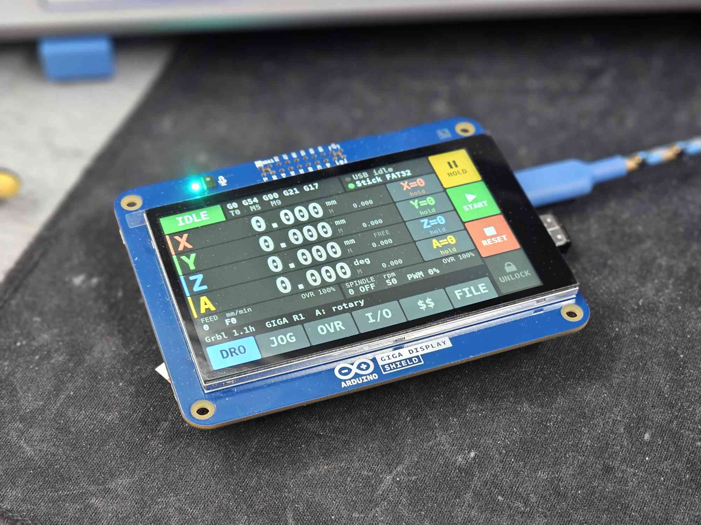
  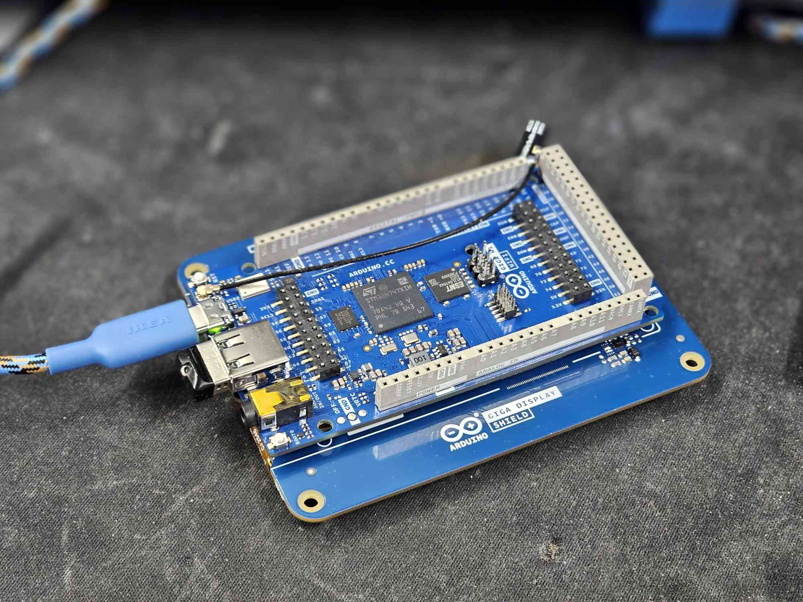
</p>

A port of [Grbl 1.1h](https://github.com/gnea/grbl) to the **Arduino GIGA R1
WiFi** (STM32H747, dual core). Grbl runs on the **Cortex-M7 at 480 MHz**; the
**GIGA Display Shield** (800x480) is driven by the **Cortex-M4 co-processor**
as a full machine status display — DRO, state, feeds, overrides, every input
and output — and as a **touch panel**: hold, start, reset, unlock, jog,
home, zero, overrides, coolant, aux outputs, collet, reset pulses and every
`$` setting. The shield's RGB LED shows the machine state.

It is the sibling of the author's ports to the Arduino UNO R4 WiFi and the
UNO Q: the Grbl core above the hardware layer is the same code, extended here
to four axes.

What this port adds to Grbl 1.1h:

* **Four axes, X Y Z A.** The A motor is a setting away from being an
  independent rotary axis, an independent linear axis, or a **second motor of
  X or Y** with automatic gantry squaring during homing (`$42`).
* **Twenty inputs and fourteen outputs, all universal.** Every function is a
  setting naming its channel (`$60`–`$93`): limit switches at both ends of
  every axis (X−, X+, …), servo alarms (`ALARM:17`), probe, buttons, door,
  the VFD's at-speed and fault relays; spindle FWD/REV, coolant, six AUX
  outputs (`M62`–`M65`, AUX0 follows the spindle for the dust extraction),
  collet, servo and VFD reset pulses. Every input NC or NO, every output
  invertible.
* **Central STOP** from the safety relay on an interrupt of its own: no step
  after it, Z brake on, every output off, `ALARM:18` until a reset.
* **Driver power watch**: the GIGA keeps running from USB when the drives
  lose their supply; a sensing input (D53) makes Grbl notice — steps end,
  brake on, `ALARM:22`, and `$H`/`$X` wait until the drives are back.
* **Handwheel pendant (MPG)**: wheel counted by a hardware timer, axis and
  x1/x10/x100 selectors, LED; the axis follows the wheel and stops with it.
* **Drive enable and Z brake sequencing** with adjustable times, by the
  shield's BRAKE output or by the drive itself.
* **Spindle at-speed and fault relays**, a **pneumatic collet** with its
  interlocks, **`M6` as a pause** for a manual tool change, and a
  **direction-to-step delay** for drives such as the Nanotec C5.
* **Programs from a USB stick** on the USB-A port, chosen and started on the
  display — the machine runs without a PC. A file is checked (`$C`) before its
  first run; STOP keeps the position. FAT32 or exFAT, MBR or GPT; files go
  onto the stick from the PC over the USB-C link (`tools/usbfiles.py`, with
  a folder sync), and the GIGA can format the stick.
* **Spindle speed** as a PWM carrier and, at the same time, as a 0–3.3 V
  analog level from the DAC for a VFD.
* **CoreXY as a setting** (`$40`, `$41`), with F meaning the speed along the
  path as on a Cartesian machine; verified pulse by pulse on both belt motors.
* **The display** runs entirely on the M4: Grbl publishes a snapshot of its
  state into shared SRAM 25 times a second and never waits for the panel.
* **Touch buttons** on six pages (DRO, JOG, OVR, I/O, `$$`, FILE), `$$`
  listing every setting with an explanation and editing it. Anything that
  moves the machine or changes offsets has to be held, a continuous jog stops
  when the finger lifts, and a touch command never splits a line the PC is
  streaming.
* **Splash screen** with the Grbl logo while the two cores and the USB stick
  start.

**Status (October 2026).** The firmware is complete and verified on a GIGA R1
WiFi with the Display Shield on the bench, without a machine: inputs, limits,
STOP and the drive supply through test hooks that drive the pins themselves
(see [Verification](#verification)). The peripheral shield — optocoupled 24 V
inputs and outputs, 0–10 V for the VFD, the handwheel connector — is at the
concept stage in [`hardware/`](hardware/Grbl_Giga_Shield/). The development
plan [PLAN.md](PLAN.md) and the pin table [PINOUT.md](PINOUT.md) are in
Slovak; the [wiki](https://github.com/karol-zalezak/GRBL_GIGA_R1/wiki) has
step-by-step guides in English and Slovak.

---

## Quick start

The sketch folder must be named `Grbl_Giga_R1`, like the `.ino` file in it
(Arduino insists), while the repository is `GRBL_GIGA_R1`:

```bash
git clone https://github.com/karol-zalezak/GRBL_GIGA_R1.git Grbl_Giga_R1
```

(or rename the folder of the unpacked ZIP). Then:

1. Install the **Arduino Mbed OS GIGA Boards** core (`arduino:mbed_giga`)
   with the Arduino IDE's Boards Manager, or:

   ```bash
   arduino-cli core install arduino:mbed_giga
   ```

   **Windows:** uploads go through the board's DFU bootloader, whose USB
   interface needs a WinUSB driver. The IDE installs it with the core (it asks
   for administrator rights); with `arduino-cli` only, run once in an
   administrator PowerShell:

   ```bash
   pnputil /add-driver "$env:LOCALAPPDATA\Arduino15\packages\arduino\hardware\mbed_giga\4.6.0\drivers\giga.inf" /install
   ```

2. **Upload the same sketch twice**, once per core, both times with
   **Tools → Flash split = "1.5MB M7 + 0.5MB M4"**:

   | Tools → Target core | What it puts on the board |
   |---|---|
   | Main Core | Grbl (motion, USB, settings) |
   | M4 Co-processor | the status display |

   From the command line, `./build.sh COM5` builds both and uploads both
   (the M7 first). The FQBNs are
   `arduino:mbed_giga:giga:target_core=cm7,split=75_25` and
   `arduino:mbed_giga:giga:target_core=cm4,split=75_25`.

   The first start after the first upload resets the board once by itself:
   the STM32H747 leaves the factory set to boot the M4 on its own, and Grbl
   switches that off (as the core's RPC library does) so that the M7 decides
   when the M4 starts.

3. Connect any Grbl sender (UGS, bCNC, Candle, ioSender, LaserGRBL) to the
   board's COM port. It is native USB, so the baud rate is irrelevant. The
   board reports itself as `Grbl 1.1h` and prints the banner whenever a sender
   opens the port.

Without the Display Shield, or without the M4 program, Grbl runs exactly the
same; `$I` and the banner report `display=0`.

---

## Wiring

The pin table is the one approved for the peripheral shield
([PINOUT.md](PINOUT.md), v2, with the additions of shield v4): every block
sits on one stretch of the headers, in the order of its terminals. The
functions in brackets are the defaults, those of shield v4 — the twenty
inputs and fourteen outputs are universal channels whose functions are
settings (see below).

2x18 header D22–D53:

| Odd column | Function | | Even column | Function |
|---|---|---|---|---|
| D23 | spare | | D22 | **IN1** (X− limit) |
| D25 | X step (PJ0) | | D24 | **IN2** (X+ limit) |
| D27 | X dir (PJ1) | | D26 | **IN3** (Y− limit) |
| D29 | Y step (PJ2) | | D28 | **IN4** (Y+ limit) |
| D31 | Y dir (PJ3) | | D30 | **IN5** (Z− limit) |
| D33 | Z step (PJ4) | | D32 | **IN6** (Z+ limit) |
| D35 | Z dir (PJ5) | | D34 | **IN7** (A− limit) |
| D37 | A step (PJ6) | | D36 | **IN8** (A+ limit) |
| D39 | A dir (PI14) | | D38 | **IN9** (probe) |
| D41 | drive enable | | D40 | **IN10** (safety door) |
| D43 | **IN17** (X servo alarm) | | D42 | **IN11** (spindle at speed) |
| D45 | **IN18** (Y servo alarm) | | D44 | **IN12** (spindle fault) |
| D47 | **IN19** (Z servo alarm) | | D46 | **IN13** (reset button) |
| D49 | **STOP** — safety relay, EXTI4 (fixed) | | D48 | **IN14** (hold button) |
| D51 | **IN20** (A servo alarm) | | D50 | **IN15** (start button) |
| D53 | **DRV PWR** — drive supply present (fixed) | | D52 | **IN16** (free) |

Top header and analog:

| Pin | Function | | Pin | Function |
|---|---|---|---|---|
| D13 | **OUT1** (spindle FWD) | | D5 | **OUT7** (AUX2) |
| D12 | **OUT2** (spindle REV) | | D4 | **OUT8** (AUX3) |
| D11 | **OUT3** (flood) | | D3 | **OUT9** (collet) |
| D10 | **OUT4** (mist) | | D2 | **OUT10** (servo reset) |
| D9 | **OUT5** (AUX0, dust extraction) | | D14 | **OUT11** (VFD reset) |
| D8 | **OUT6** (AUX1) | | D15 | **OUT12** (AUX4) |
| D6 | **OUT13** — or the spindle PWM (TIM4_CH2, 1 kHz, 60000 steps) with `$38` | | D16 | **BRAKE** — Z brake (fixed) |
| A2 | **OUT14** (AUX5) | | D7 | spare (input only: JTAG pull-up) |
| A12 (DAC0) | spindle speed 0–3.3 V (0–10 V after the shield) | | A0, A1 / A4–A6 | operator panel: potentiometers / START, HOLD, STOP |

**The GIGA is a 3.3 V board and its pins are not for 5 V or 24 V signals.**
The shield (PINOUT.md) puts every input behind an optocoupler and every
output behind an optocoupler and a transistor, on an isolated 24 V side. On a
bare board the inputs have internal pull-ups and are **active low** — a
switch or an open-collector output to GND — and the outputs drive 3.3 V.

Pins D68–D75 (display connector), SDA1/SCL1 next to AREF (the display's touch
and LED bus), D0/D1 and D20/D21 are left free; D17–D19 are the RS485 port to
the spindle VFD (shield v4, `$33`, see below). D54–D67 (the camera pins) are
free as well and reach the shield through the Display Shield's camera socket
J3 (PLAN.md part 5).

All four step pins are on GPIO port J, so a step is one 32-bit store. Inputs
are polled by a timer and outputs resolved to port bits at start-up, so any
pin can be moved in `src/cpu_map.h`.

---

## The fourth axis (`$42`, `$43`)

| `$42` | A is | Units | `G20` scales A | A words |
|---|---|---|---|---|
| 0 (default) | independent **rotary** axis | degrees | no | allowed |
| 1 | independent **linear** axis | mm | yes | allowed |
| 2 | **second motor of X** | — | — | `error:20` |
| 3 | **second motor of Y** | — | — | `error:20` |

As an independent axis A has its own `$103` (steps/deg or steps/mm), `$113`
(max rate), `$123` (acceleration) and `$133` (travel), takes part in arcs as a
linear axis (it moves in proportion along a `G2`/`G3`, like the helical axis),
and counts towards the feed rate like the other axes (degrees as if mm).
`$43=1` homes it as the last cycle of `$H` (and `$HA` homes it alone); with
`$43=0` it is not homed and soft limits ignore it.

As a **slave** the A driver repeats every step pulse of its master axis. Its
direction follows the master's, inverted by its own `$3` bit (bit 3) for a
motor mounted mirror-image. The A settings are then unused and A reports 0.
During homing of the master, the two motors **stop independently**: the master
on its own limit switch, the slave on the **A− / A+ switch** (`$66`, `$67`). That squares
the gantry every time it is homed. If one switch has triggered and the other
has not within 5 % of the other axis's travel (2.5–25 mm), homing stops with
`ALARM:10` rather than rack the frame — upstream Grbl 1.1h's dual-axis check,
now a run-time setting instead of a build option.

Changing `$42` is only accepted while idle or in alarm. A slave cannot be
combined with CoreXY (`$40=1`); each setting refuses the other with `error:5`.

---

## CoreXY (`$40`, `$41`)

`$40=1` switches the machine to CoreXY belt kinematics at run time — no
rebuild. Motor A of the CoreXY drawings is the **X driver** (D25/D27), motor
B the **Y driver** (D29/D31):

    A = X + Y        X = (A + B) / 2
    B = X - Y        Y = (A - B) / 2

so an X move turns both motors the same way, a Y move turns them in opposite
directions, and a 45° diagonal turns only one of them, twice as far. Z and A
stay ordinary axes. Getting the two belt motors right, with `G91 G0 X10`
and `G91 G0 Y10`:

| What happens | Fix |
|---|---|
| X command moves along Y (and Y along X) | invert one belt motor (`$3` bit 0 or 1) |
| X right, Y backwards | swap the two motors (X and Y driver outputs) |
| both backwards | invert both belt motors (`$3` bits 0 and 1) |

Both belt motors need the same `$100`/`$101`.

* **Feed rate.** F is the speed of the tool along the programmed path, as
  RS274/NGC defines it and as on a Cartesian machine. (Upstream Grbl's CoreXY
  plans in motor space, where every XY path is exactly √2 longer, so its
  `G1 X60 F3600` takes 1.41 s instead of 1.0 s.)
* **`$41` — what `$110`/`$120` limit.** `$41=0` (default): each belt motor,
  so on a diagonal, where one motor does all the work, the head runs at
  1/√2 of `$110`. `$41=1`: the head's X and Y axes, exactly like a Cartesian
  machine; a motor then turns up to 2 × `$110` on a diagonal, so size `$110`
  for that.
* **Homing** works on CoreXY as on Cartesian except that X and Y must home
  in separate cycles (a CoreXY frame cannot drive both to their switches at
  once). The default cycles in `config.h` are Z, then X, then Y; if you change
  them to home X and Y together, `$40=1` is refused.
* Positions in `?`, `$#`, the probe result and the display are the head's
  Cartesian position; `$I` reports the raw pulse count of every driver
  (`motor=`), which is how the tests check the belts.

---

## Inputs and outputs

The peripheral shield has **twenty inputs IN1–IN20** and **fourteen outputs
OUT1–OUT14**. None of them has a fixed job: each function is a setting holding
the number of the channel it is on (0 = not used), so the wiring is changed in
`$$`, not in the source. Fixed are only step/direction/enable, the central
STOP (D49), the driver power input (D53), the Z brake (D16), the DAC (A12)
and the operator panel; OUT13 (D6) is the spindle PWM instead with `$38` > 0.
The defaults are those of shield v4, whose servo alarms come in on IN17–IN20
next to their DE-15 connectors; they apply to new settings (`$RST=$`) — an
update keeps the assignment a board already has.

| Setting | Input function | Default | `Pn:` |
|---|---|---|---|
| `$60`–`$67` | limit switches X−, X+, Y−, Y+, Z−, Z+, A−, A+ | IN1–IN8 | `X` `Y` `Z` `A` |
| `$68`–`$71` | servo alarms X, Y, Z, A | IN17–IN20 | `M` |
| `$72` | probe (`G38.x`) | IN9 | `P` |
| `$73`–`$76` | reset, feed hold, cycle start, safety door buttons | IN13, IN14, IN15, IN10 | `R` `H` `S` `D` |
| `$77` | spindle at speed (VFD relay) | IN11 | |
| `$78` | spindle fault (VFD relay) | IN12 | |
| `$79` | **NC mask**: bit n−1 = INn, bit 20 = STOP, bit 21 = DRV PWR | 0 (all NO) | |

| Setting | Output function | Default |
|---|---|---|
| `$80`, `$81` | spindle **FWD** (`M3`), **REV** (`M4`) — never both | OUT1, OUT2 |
| `$82`, `$83` | flood `M8`, mist `M7` | OUT3, OUT4 |
| `$84`–`$89` | AUX0–AUX5 (`M62`–`M65 P0`–`P5`) | OUT5–OUT8, OUT12, OUT14 |
| `$90` | collet open | OUT9 |
| `$91` | servo alarm reset (pulse) | OUT10 |
| `$92` | VFD fault reset (pulse) | OUT11 |
| `$93` | **inverted outputs**: bit n−1 = OUTn | 0 |

An input is **active when its optocoupler conducts** (it pulls the pin, which
has a pull-up, to GND — on a bare board a switch to GND does the same). A bit
in `$79` makes the channel active while the optocoupler is *off*, for normally
closed contacts, where a broken wire then trips too. The two limits of one
axis may share a channel; any other double use, and two functions on one
output, are refused with `error:42`. A free input still shows on the display
and in `$I`.

**Limit switches, one or two per axis.** X− and X+ on two channels: Grbl knows
which end was hit and says so (`ALARM:1` followed by `[MSG:Limit X-]`). X+ on
the same channel as X−: two switches in series, as in upstream Grbl
(`[MSG:Limit X]`). X+ = 0: the axis has a switch at the minus end only. A hard
limit trips when a switch **closes**. While one is held — after `ALARM:1`,
reset and `$X` — the axis may move away from it, and only away: a jog into it
is refused with `error:41`, any other motion into it trips `ALARM:1` again. So
an axis is jogged off its switch with hard limits left on. (With two switches
in series Grbl cannot tell the side, and the axis can move either way while
the switch is held, as upstream.)

**Homing** uses the switch at the end `$23` sends the axis to (bit set = minus).
`$H` is refused with `error:45` if that end has no switch. With two inputs on
an axis, the switch at the **far** end closing during homing stops it with
`ALARM:20` — a wrong `$23` or swapped wires. A slave A motor homes on the
A− / A+ switches, squaring the gantry as before.

**Servo alarms** (`$68`–`$71`). A drive in fault stops the machine at once, in
any state but alarm — idle included, because a servo that faults while holding
position has lost it all the same — with `ALARM:17` ("motor fault", the number
grblHAL uses). Like a hard limit it needs a reset, and the next reset (or
unlock) gives the drives a `$55` ms pulse on the **servo reset** output. The
inputs are debounced for 2 ms, limits for 0.3 ms, buttons for 10 ms.

**Outputs.** `M2`/`M30` and a reset switch every output off. `$46` lists the
AUX outputs that also switch on whenever the spindle runs (default AUX0, the
dust extraction). `$93` inverts outputs at the pin; the display and the
M-codes keep showing the logical state. Changing an assignment switches the
function off first. OUT13 (D6) and OUT14 (A2) are outputs like the others —
OUT13 only while `$38=0`: with the PWM on, the timer owns D6 and no function
may be put on OUT13 (`error:42`; `$38` > 0 is refused while one is).

### Central STOP (`$57`, D49)

The safety relay does the safety function: it cuts the power of the drives,
the VFD, the brake and the valves, independently of the firmware. Its signal
contact on **D49** makes Grbl agree with it at once — the drives may still run
for a moment on their capacitors and must not get another step. D49 (PE4) has
an interrupt of its own, EXTI4, at NVIC priority 0, above the stepper, the
input scan and all of mbed; the 10 kHz scan watches it too (STOP present at
power-up, or a missed edge). The interrupt:

1. stops the step timers and puts the step pins at rest,
2. engages the Z brake and disables the drives,
3. switches every output off — spindle FWD/REV, PWM, DAC, coolant, AUX,
   collet — by register writes, no mbed calls,
4. then hands over the Grbl way: `mc_reset()` and **`ALARM:18`**,
   `[MSG:E-stop]`, `Pn:E` in the status.

The routine takes about **11 µs** to the last output; the stepper interrupt
checks the latch with interrupts masked right before it writes a step, so no
pulse follows the trip. Grbl stays in alarm: `$X` and `$H` are refused with
`error:40` while STOP is active, and also after it is released until a reset
— the reset then finds STOP released (for 100 ms) and ends the latch. A reset
with STOP still active keeps `ALARM:18`. `$57=0` (default, until the relay is
wired) switches the input off; bit 20 of `$79` chooses whether the contact is
closed or open for STOP. `$I` shows `estop=<state>/<trips>/<last trip time in
0.1 µs>/<1 interrupt, 2 scan>`. The display covers the page with a red
**E-STOP** banner and blinks the RGB LED red.

### Driver power (`$94`, `$95`, D53)

The GIGA runs on as long as USB powers it, also when the drives have lost
their supply — and then its step counter claims a position the motors no
longer hold. **D53** senses the drive supply through an optocoupler of its
own (low = supply present; the shield's sensing circuit in PLAN.md part 5)
and makes Grbl agree with the drives:

* **supply gone for 2 ms** (`DRVPWR_LOSS_SCANS`): the Z brake engages and the
  enable drops at once (the drives cannot hold the axis any more; a brake left
  released by the BRAKE output would let Z fall), then `mc_reset()` and
  **`ALARM:22`** — in motion, idle, homing (not `ALARM:6`), and reported even
  when Grbl is already in another alarm, since a position kept over that one
  is gone now;
* **while it is off**, and until it has been back for **`$95` ms** (the
  drives' boot time, default 1000), `$H` and `$X` are refused with
  **`error:50`**; then Grbl says `[MSG:Driver power on]` and HOME or UNLOCK
  continues. Anything that left the alarm while the supply is off lands
  straight back in it.
* **at power-up** without the supply Grbl starts in `ALARM:22`.

Not a critical alarm: no reset needed. `$94=0` (default, until the shield
senses the supply) switches it off — a bare board reads "no supply" on D53.
Bit 21 of `$79` inverts the input, for a drive's ready contact that is open
when ready. `$I` shows `drv=<0 not watched, 1 off, 2 back but $95 not over,
3 on>/<losses since power-up>`; the display shows a red / amber / green
**PWR** beside DRIVES on the I/O page and what to do on the message line.

### Handwheel pendant (`$96`–`$98`, D54–D63)

A handwheel pendant such as the EHDW-BG6L: a quadrature wheel (100 detents a
turn), an axis selector OFF / X / Y / Z / 4 / 5 / 6, a step selector x1 /
x10 / x100 — each position a contact to the pendant's 0 V — and an LED. It
comes in on the camera pins, which the Display Shield passes through its
socket J3 (PLAN.md part 5):

| Signal | Pin | | Signal | Pin |
|---|---|---|---|---|
| wheel A | D54 (PI5, TIM8_CH1) | | step x1 | D60 |
| wheel B | D59 (PI6, TIM8_CH2) | | step x10 | D61 |
| axis X, Y, Z | D55, D56, D57 | | step x100 | D62 |
| axis 4 (= A) | D58 | | LED (output) | D63 |

**TIM8 counts the wheel** in hardware (encoder mode, every edge of both
inputs through a ~4 µs filter), so no interrupt is spent on it. The selector
inputs are active low with pull-ups (the pendant's contact, or the shield's
optocoupler, pulls them down) and debounced for 20 ms. Positions 5 and 6 and
OFF select nothing.

Every 20 ms, at the point of the main loop where the touch screen's commands
run (no line from the PC half received), the detents turned become one jog
`$J=G21G91<axis><detents × step>F<feed>` — the feed being the one that covers
it in those 20 ms, so the **axis follows the wheel's speed**. A block holds
at most 20 ms of motion at `$98`, at most 3 are queued and at most 2 periods
wait: turning faster than the axis can follow is **dropped, not stored up**,
and the axis stops within some 100 ms of the wheel even at full speed. The
wheel moves the machine only in Idle (nothing planned) or during its own
jog — not during a program, a hold, an alarm, check mode or a jog from the
PC or the touch screen. **Another axis or OFF cancels its jog at once.** At a
soft limit the axis stops at the limit rather than the jog being refused.
A pause of the main loop longer than 100 ms (a hold, a dwell) forgets what
was turned meanwhile.

| Setting | Default | |
|---|---|---|
| `$96` | 0 | 0 off, 1 on, 2 on with the direction reversed |
| `$97` | 0.001 | distance of one detent at x1 (mm, degrees for a rotary A); x10 and x100 are 10× and 100× |
| `$98` | 3000 | highest feed the wheel moves an axis at (mm/min), never above the axis's `$11x` |

The **LED** is on while the wheel moves the selected axis, blinks while an
axis is selected but the machine cannot jog, and is off at OFF. The display's
JOG page shows the axis and the step (or "blocked") left of Y+, and `$I` has
`mpg=<state 0 off, 1 no axis, 2 ready, 3 blocked>/<axis 0, 1-4>/<step>/<TIM8
count>/<selector inputs>/<LED>`.

### Drive enable and the Z brake (`$1`, `$48`–`$50`, `$59`)

The brake is released while its coil is powered: the BRAKE output **D16**
(a 5 A MOSFET on the shield). With `$59=1` Grbl sequences it with the drive
enable:

    drives on --$48--> brake released --$49--> first step
    motion over --$1--> brake on --$50--> drives off

Nothing blocks: the stepper interrupt starts at once but puts out no step
until the brake has had its time, and the switch-off is timed from the main
loop (upstream spun for `$1` ms inside the stepper interrupt). An alarm
engages the brake at once and drops the drives `$50` later; STOP drops both at
once. With `$1=255` the drives stay enabled and the brake released, so the
times apply only after an alarm or a reset. With `$59=0` the drive works its
own brake (Delta BRKR, Nanotec C5 output 1): BRAKE stays off, `$48`+`$49`
still pass before the first step, and the drives drop without waiting.
Defaults 200/100/200 ms, on the long side until the brake is measured. `$I`
shows `en=` and `brake=`.

### Spindle: at speed, fault, collet, M6

* **At speed** (`$77`, `$52`). After `M3`/`M4` and after every S change, Grbl
  waits — like `G4` — for the VFD's "frequency reached" relay, at most `$52`
  ms, then `ALARM:14` and the program stops (planner and parser reset, the
  position kept). After a speed change of a running spindle the relay is
  ignored for 250 ms, until the VFD has seen the new set point through its
  input filter. While cutting, losing the relay is handled per `$53`: 0
  ignore, 1 feed hold (resume with START once it is back), 2 alarm after a
  controlled stop. `$52=0` (default): no waiting, the fixed `$54` instead. Not
  in laser mode.
* **Resume with the spindle at speed.** A feed hold in which the spindle was
  stopped (the spindle stop override, STOP on the OVR page) or its speed
  changed, and a closed safety door, resume only once the spindle is back at
  speed: the cycle START waits — still `Hold:0` — for the relay or the drive
  (up to `$52` from the restart, then `ALARM:14`, position kept); without
  at-speed monitoring until `$54` has passed since the restart (0: at once,
  as upstream — the door then keeps upstream's 4 s). Upstream Grbl resumes the
  move at once (the door after a fixed 4 s).
* **VFD fault** (`$78`). FWD/REV drop at once — so that resetting the VFD
  cannot restart the spindle — motion stops with a feed hold, and once the
  machine stands, `ALARM:19` with the position kept. `$X` and `$H` are refused
  with `error:43` while the fault input stays active; a reset or `$X` pulses
  the **VFD reset** output (`$92`, `$55` ms).
* **Collet** (`$90`). Opens only with the spindle off for `$51` ms (and the
  at-speed relay open), the machine idle or in a finished hold, and no STOP —
  `error:44` otherwise. While it is open, `M3`/`M4` are refused with
  `error:39` and a hold does not resume. On the display: COLLET on the I/O
  page (hold to open, tap to close), which works even during an M6 pause;
  from the PC `$COLLET=1` / `$COLLET=0`.
* **`M6`** (`$58=1`, default): finish the motion, stop the spindle, pause like
  `M0` with `[MSG:Tool change T<n>, cycle start to resume]`. Change the tool
  with the COLLET button, then START. `$58=0`: refused as in upstream Grbl.

### Operator panel (`$39`, `$44`, `$45`, A0/A1, A4–A6)

Shield v4 brings a small panel straight to the GIGA's analog header — not
isolated, short wires to the control cabinet, JST XH connectors:

| Signal | Pin | Wiring |
|---|---|---|
| potentiometer 1 | A0 (PC4) | 10 k from +3V3 through 100 Ω, wiper through 1 k, 100 nF at the pin |
| potentiometer 2 | A1 (PC5) | as potentiometer 1 |
| START | A4 (PC3) | button to GND, 10 k pull-up, 1 k + 100 nF |
| HOLD | A5 (PC2) | as START |
| STOP | A6 (PC0) | as START |

* **Buttons** (`$39=1`, default — the internal pull-ups keep unwired pins
  released). **START** and **HOLD** are cycle start and feed hold, exactly as
  those functions on an input channel (same 10 ms debounce, `Pn:S` / `Pn:H`).
  **STOP** ends the program with a controlled stop: feed hold, and once the
  machine stands Grbl resets with the machine declared stopped — position
  kept, no alarm, spindle and coolant off, `[MSG:Panel STOP]`. Standing, it
  resets at once (spindle off); a program from the USB stick stops as its own
  STOP; homing, which knows no hold, is reset. **Not the safety STOP on D49.**
* **Potentiometers** (`$44` for A0, `$45` for A1; 0 none, 1 feed override,
  2 spindle override, 3 rapid override; default 0 — usually `$44=1`, `$45=2`).
  Feed and spindle: 10–100 % over the left half, **100 %** in a band of
  ±2.5 % around the middle, 100–200 % over the right half; rapid: thirds,
  25 / 50 / 100 %. A potentiometer sets its override when it is **turned**
  (by more than 1.5 %) — and once at start-up and after every reset — through
  Grbl's own override steps, so the PC and the touch screen can still change
  the override in between; the knob takes over again when it moves.

`$I` shows `pnl=<buttons: bit 0 START, 1 HOLD, 2 STOP>/<A0>/<A1>` (readings
0–4095, 0 while off).

### Spindle VFD over RS485 (`$33`–`$37`, D17–D19)

Shield v4 has an isolated RS485 port (ADM2587E) for the spindle VFD on
**Serial2 = USART2**: **D18** TX (PD5), **D19** RX (PD6), and **D17** (PI9)
switches the transceiver to transmit (high) or receive (low; a 10 k
pull-down on the shield keeps it receiving while the GIGA boots). Half
duplex, 120 Ω termination by jumper. With `$33=1` Grbl is a **Modbus RTU**
master on it and runs the drive over the bus — in addition to the FWD/REV
outputs and the 0–10 V on A12, which keep working, so either wiring works.

| Setting | Default | |
|---|---|---|
| `$33` | 0 | drive: 0 none (0–10 V and relays only), 1 Delta (MS300, C2000, VFD-E, …) |
| `$34` | 1 | Modbus address of the drive (1–247) |
| `$35` | 9600 | baud rate (1200–115200) |
| `$36` | 1 | frame: 0 8N1, 1 8N2, 2 8E1, 3 8O1, 4 8E2, 5 8O2 |
| `$37` | 400 | drive frequency at S = `$30` (Hz, up to 655.35) |

* **`M3` / `M4`** run forward / reverse, **`M5`** and `S0` stop. The
  frequency is S / `$30` × `$37`, with S limited to `$31`–`$30` and scaled by
  the spindle override exactly as for the PWM output: `$30=24000`, `$37=400`,
  `S12000` → 200.00 Hz.
* **Every 100 ms** Grbl reads the drive's error code, status, set point and
  output frequency (which also feeds the drive's own communication watchdog),
  and that takes the place of the relay contacts:
  * **at speed** — output frequency within 2 % of the set point (at least
    0.5 Hz) and the drive running the way it was told: `$52` waits for it
    after `M3`/`M4`/S and `$53` watches it while cutting, as with the relay
    (which is not used while `$33` > 0);
  * **fault** — the drive reports an error code: spindle off, controlled
    stop, `ALARM:19`, `$X` refused (`error:43`) until it clears; a reset or
    `$X` sends the drive's fault reset (and pulses `$92` as before). The fault
    relay (`$78`), if assigned, still counts as well;
  * **collet** — stays closed while the drive reports any output frequency,
    or has not been seen standing since it was last told to run.
* **`ALARM:23`** (after a controlled stop, position kept) when the drive
  cannot be trusted with the spindle: no valid answer after three tries while
  the spindle should run or may still run; a command it refused (a Modbus
  exception — a frequency above its maximum, say); or a drive that does not
  run, stop, turn or take the frequency as told for 1 s (its run command on
  the keypad, say) — Grbl repeats the command meanwhile; or a drive that ran
  as told and then stopped by itself (its keypad STOP, a stop input): no
  repeat then, which would start it again, but the alarm at once. `$X` and `$H` are
  refused with **`error:51`** while that lasts. A silent drive with the
  spindle off and standing is no alarm, it only shows in `$VFD` and `$I`. A
  drive that was told to run and then went silent keeps `$X` refused until it
  answers again (or `$33=0`): set its own communication timeout so it stops
  by itself.
* Not with laser mode: `$32` and `$33` exclude each other (`error:5`).
  `$33`–`$36` change only with the spindle stopped (`error:8`).

Delta drive parameters (the VFD-E numbers some of them differently):

| | MS300 / C2000 | VFD-E | |
|---|---|---|---|
| frequency source | `00-20`=1 | `02-00`=3 | RS485 |
| run command source | `00-21`=2 | `02-01`=3 | RS485; on the VFD-E 3 keeps the keypad STOP, 4 turns it off |
| address | `09-00` | `09-00` | = `$34` |
| baud rate | `09-01` in kbps (9.6) | `09-01`: 0 4800, 1 9600, 2 19200, 3 38400 | = `$35` |
| on a communication loss | `09-02`=1 or 2 | `09-02`=1 or 2 | warn and ramp / coast to a stop; 3 (the VFD-E's factory setting) keeps running and leaves `09-03` without effect |
| communication timeout | `09-03`=3.0 | `09-03`=3.0 | s; Grbl asks every 0.1 s, a settings write to flash can hold the main loop for up to 2 s |
| RTU frame | `09-04` = 12 + `$36` (13 = 8N2) | `09-04`: 6 8N1, 3 8N2, 4 8E1, 5 8O1, 7 8E2, 8 8O2 | = `$36`; the VFD-E's factory 0 is Modbus ASCII, which Grbl does not speak |
| highest output frequency | `01-00` | `01-00` | ≥ `$37` |

On the VFD-E the RS485 is its RJ-45 socket: pin 5 SG+ to A, pin 4 SG− to B,
pin 3 GND (pin 2 feeds the keypad, leave it free); the VFD\*E\*C models
(CANopen) have it on other pins. `$VFD=R0900,5` reads back `09-00`–`09-04`,
`$VFD=R0200,2` the VFD-E's `02-00`/`02-01` and `$VFD=R0100` its `01-00`
(0.01 Hz).

**`$VFD`** prints what Grbl knows:

    [VFD:Delta link=OK want=FWD,200.00 drive=FWD,200.00,199.50 err=0 st=0503
     remote=3 at=1 trouble=0 tx=1204 ok=1204 retry=0 fail=0 exc=0/0 sim=0 clk=120]

`link` OFF (`$33=0`), WAIT (no answer yet), OK, LOST; `want` the command and
frequency Grbl wants; `drive` what the drive reports: run state, set point,
output frequency; `err` its error code, `st` its status word (2101H, hex);
`remote=3` frequency and run command both from RS485 (`00-20`/`00-21`, on
the VFD-E `02-00`/`02-01`, right);
`trouble` 1 silent, 2 refused, 3 not following, 4 stopped by itself; then the transactions, their
retries, failures and exceptions (count / last code), and the USART2 kernel
clock in MHz. **`$VFD=R2100,4`** reads up to 8 registers, **`$VFD=W2000,12`**
writes one — address and value hexadecimal, Idle or Alarm only; `$VFD=R0900`
reads the drive's own `09-00`. After a write Grbl sends its command and
frequency again. `$I` has `vfd=<link 0 off, 1 waiting, 2 ok, 3 lost>/<error
code>/<output frequency, 0.01 Hz>/<failed transactions>`.

How it runs: USART2 interrupt-driven with its 16-byte FIFOs on, below the
Grbl timers; D17 goes high 3 µs before the first start bit, the receiver is
off while sending (no echo, whatever the transceiver's ~RE does) and D17
drops in the transmit-complete interrupt after the last stop bit; a frame
ends with the USART's receiver timeout after 3.5 characters (1.75 ms above
19200 baud). One transaction at a time from the main loop (`vfd_service()`),
never waiting for the line: CRC-16, a 100 ms answer timeout, two retries,
exceptions; a stop goes out before anything else. Other vendors (Huanyang
and the like) are a profile in `src/vfd.c` — their registers and the meaning
of their status; the rest is common.

### Direction setup (`$56`)

Some drives need time between a direction change and the next step — the
Nanotec C5 35 µs. With `$56` > 0 the first step after a direction change is
held back until the direction has stood that long: the step pulse timer's
delay phase raises the step pins late, and that one stepper period is
stretched to make room. All other steps are unchanged. `$I dir=` shows how many
steps were held back and the shortest direction-to-step time since the last
reset (35.4 µs measured with `$56=35`; 0 with `$56=0`).

### Test hooks

For tests without a machine (all used by `tests/test_io.py`):

* `$TIN=n,1` pulls input channel n (21 = STOP, 22 = DRV PWR) low — exactly what a
  conducting optocoupler does, so the input takes its normal path (debounce,
  the STOP interrupt) — and `$TIN=n,0` releases it; `$TIN=n,v,ms` does it ms
  from now (Grbl parses no line during a hold or homing); `$TIN=0,0` releases
  all.
* `$TSW=n,X+5` makes channel n read active while the machine position of X
  is at or above 5 mm (`X-5`: at or below) — a virtual limit switch that
  closes and opens with the motion, for homing. `$TSW=0` removes them.
* `$TMPG=axis,step` turns the handwheel's selectors (axis 0 = OFF, 1–4 =
  X Y Z 4; step 1, 10, 100, 0 = none) by pulling those pins down;
  `$TMPG=0,0` releases them. `$TMPW=n[,rate]` turns the wheel n detents
  (negative: backwards) at rate detents a second (default 100) by switching
  the pulls of the A and B pins in quadrature from the input scan — TIM8
  counts the real edges.
* `$TPNL=mask[,ms]` presses the operator panel's buttons (bit 0 START, 1
  HOLD, 2 STOP) as if their pins were low, ms from now if given; `$TPNL=0`
  releases them. `$TPOT=n,value` gives potentiometer n (1 = A0, 2 = A1) the
  reading value (0–4095) instead of its pin, `$TPOT=n,-1` hands it back
  (`tests/test_panel.py`).
* `$TVFD=mode[,code]` puts a simulated Delta drive in place of the RS485
  port; it gets the very frames the port would send: 1 healthy (output ramps
  at 400 Hz/s; an error it reported stays latched until its fault reset), 2
  in fault with error code (default 2; the fault reset does nothing while it
  lasts), 3 silent, 4 every second answer broken, 5 ignores run and stop
  (keypad control), 6 its keypad STOP pressed once (it stops, and runs again
  when told: mode 1 afterwards); 0 the port again (`tests/test_vfd.py`).

* `$SPLASH[=ms]` shows the splash screen again, for at least ms (default
  3000) — for screenshots.

None of them survives a power cycle; all survive a reset on purpose.

The spindle **speed** is an analog level on A12 — 0 V at S0 and 3.3 V at
`$30` — and, with **`$38`** > 0, also a PWM carrier on D6 (= OUT13, TIM4_CH2,
1 kHz). `$38`: **0** off (default; D6 is OUT13), **1** PWM, **2** PWM
inverted at the pin — for a TTL PWM input behind OUT13, which sinks to 0 V
when the pin is high, so that input sees the right duty (beware: with the
GIGA not yet driving the pin, during boot, such an input sees full power;
give the laser its own enable). Laser mode (`$32=1`) needs the PWM
(`error:17` otherwise) and modulates both per motion segment, as upstream
does with the PWM pin.

## Programs from a USB stick

The machine runs without a PC: put the G-code on a stick — **FAT32 or
exFAT** (FAT16 too), with an MBR or a **GPT** partition table — plug it into
the GIGA's **USB-A** port, pick the file on the display's **FILE** page and
hold START. A PC on USB-C stays optional — a sender can watch (status reports
carry the progress), pause and resume, but is not needed. The stick can also
stay in the GIGA for good: files go onto it from the PC through the USB-C
link (below), and the GIGA formats it if need be.

**How it runs.** The USB-A port is a USB host on the **M4**, in a thread of
its own (`src/m4/usbstick.cpp`), so Grbl on the M7 never sees a USB host
interrupt. The M4 mounts the stick with its own FatFs R0.15
(`src/m4/fatfs/` — mbed's built-in FatFs knows neither exFAT nor GPT, and
sticks come with both), lists the G-code files of its root directory
(`.nc .ngc .gcode .gc .tap .txt .cnc`, up to 40, sorted by name; names up to
47 characters, as UTF-8 — the display shows accented letters without their
accents) and, on request, streams a file into an 8 kB ring in the shared
SRAM4 (about 510 kB/s from a stick; a program needs 25 kB/s at most).
Grbl takes lines out of the ring from its main loop, as fast as the planner
has room, and runs them through the same function lines from the PC go
through (`src/job.c`):

1. **Start** — only in Idle with an empty planner and no STOP; from the
   display also only after the PC has been quiet for a second.
2. **Check pass** — a file not run before (name, size and date) first goes
   through Grbl's check mode (`$C`: parsed, nothing moves), which also counts
   its lines and finds the X/Y/Z range it moves in (work coordinates). An
   error ends it there with its line number; the parser state from before —
   G91, G92, the tool — is put back. A file that ran before unchanged skips
   the check.
3. **Run** — from the top. `M0` and `M1` pause (START resumes), `M6` is the
   tool change pause (`$58`), `M2`/`M30` end the program.
4. **STOP** (FILE page, or `$FS`) holds the machine, waits until it stands and
   resets Grbl with the machine declared stopped: **the position is kept**, no
   `ALARM:3`. A G-code error while running stops it the same way and ends in
   `ALARM:21`; a reset, an alarm or the central STOP end it at once; a stick
   pulled out stops it like STOP, at once — not after the lines already read
   ahead into the ring, which could be seconds of motion.

While a program runs, a line from the PC is answered at once: the read-only
`$` commands (`$$ $G $# $I $N $F`) and `$FS` work, any other line is refused
with `error:48`. The status report carries `|SD:<percent>,<file>` (grblHAL's
field for SD card jobs), and Grbl reports the steps on `[MSG:USB job ...]`
lines.

**On the display** — the sixth tab, FILE: the listing with size, prev/next,
and for the selected file what the last run found (lines, range, result);
START, held 1 s. While a program runs the page shows its name, state, a
progress bar, the line, elapsed and remaining time, and STOP (held 0.5 s);
HOLD and START in the right column pause and resume. The top bar shows the
stick on every page (below the USB cable): `No USB stick`, `Stick mounting`,
`Stick FAT32` / `Stick exFAT` (green), `Stick NTFS` / `Stick error` (red),
`Formatting...`, and while a program runs `45%  L1234`; the message line
says how the last program ended.

**From the PC:**

| Command | |
|---|---|
| `$F` | the stick's state, file system, size and free space; its files (`[FILE:name\|SIZE:n\|DATE:2026-10-13T02:33:22]`); the job (`[JOB:state\|name\|LINE:\|POS:\|ERR:\|ALARM:\|CHECKED:\|MS:\|RANGE:]`) |
| `$F=name` | runs a file (as listed; the name is matched without case) |
| `$FS` | STOP |
| `$FR` | reads the directory again |
| `$FT=name` | read test: reads the file through the ring to the end, prints bytes, lines, CRC-32 and the rate |
| `$FW=name`, `$FW+<hex>`…, `$FWE=YYYYMMDDhhmmss` | writes a file onto the stick, dated as given (`$FWA` gives the upload up) |
| `$FD=name` | deletes a file |
| `$FF=ERASE` | formats the stick: FAT32 up to 32 GB, exFAT above (`$FF=EXFAT`: exFAT whatever the size) |
| `$FX=lba` | diagnostics: one sector of the stick in hex (`[SEC:…]`), mounted or not |

What follows `=` in a `$F` command is taken as it comes — case, spaces,
brackets — so `$F=Front panel (v2).nc` works. Writing, deleting and
formatting only in Idle or Alarm, and not while a program runs.

New status codes: `error:46` no stick, `47` the file cannot be read or
written (a `[MSG:USB stick: …]` line says why), `48` a program from the
stick runs, `49` the PC is sending (the display does not start then). New
alarm: `ALARM:21` program stopped by a G-code error.

**Files from the PC onto the stick** — `tools/usbfiles.py` (Python 3 with
pyserial), with the stick in the GIGA and no sender on the port:

```
python tools/usbfiles.py ls
python tools/usbfiles.py put part.nc "Front panel.nc"
python tools/usbfiles.py sync D:\CNC\programs
python tools/usbfiles.py rm old.nc
python tools/usbfiles.py format
```

`sync` copies the G-code files of a folder that are new or changed (by size
and date: a copy keeps the PC file's date) and, with `--delete`, removes the
ones the folder no longer has; `--dry-run` only shows it. Every copy is read
back on the GIGA and its CRC-32 compared with the PC file's. The data goes as
hex over the serial link at about 135 kB/s — a 2 MB file in 15 s. Names lose
their accents on the way (`frézka.nc` → `frezka.nc`), and `!`, `~`, `?`
become `_` (real-time commands to Grbl). `format` asks for `ERASE` first.

**FORMAT on the display** — the button beside the stick's status on the
FILE page, **held 3 s** (a tap only says so): FAT32 up to 32 GB, exFAT
above, one partition over the whole stick; an 8 GB stick takes 10 s (FAT32)
or 5 s (exFAT). Everything on the stick is lost. The MBR is the one Windows
writes — a disk signature, the partition from 1 MB — and only that partition
is left to FatFs's f_mkfs(), whose own MBR has no signature (above 128 GB
FatFs makes a GPT).

**Tests:** `tests/test_job.py` and the FILE page test of `test_touch.py`
need a FAT32 or exFAT stick in the GIGA. They put their files onto it as
`zz_<name>` and delete them again at the end; the stick's own files stay as
they were.

The host stack is a copy of the parts of
[Arduino_USBHostMbed5](https://github.com/arduino-libraries/Arduino_USBHostMbed5)
0.3.1 a stick needs, in `src/m4/usbhost/` (see its README): the library
selects the GIGA's USB-A port only when built for the M7, and on the M4 it
would take the USB-C port Grbl talks to the PC on. The file system is
ChaN's FatFs R0.15 in `src/m4/fatfs/` (see its README). Nothing to install.

---

## The display and the touch screen

| DRO | JOG |
|---|---|
| 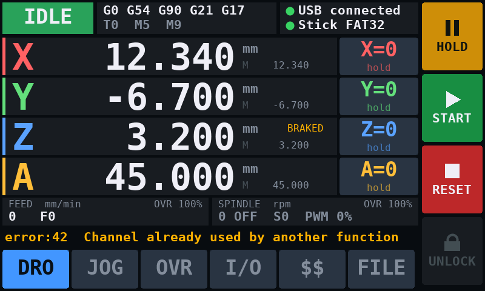 | 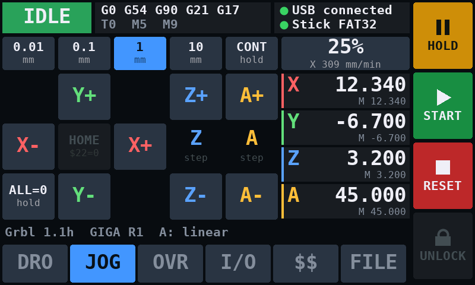 |
| **OVR** | **I/O** |
| 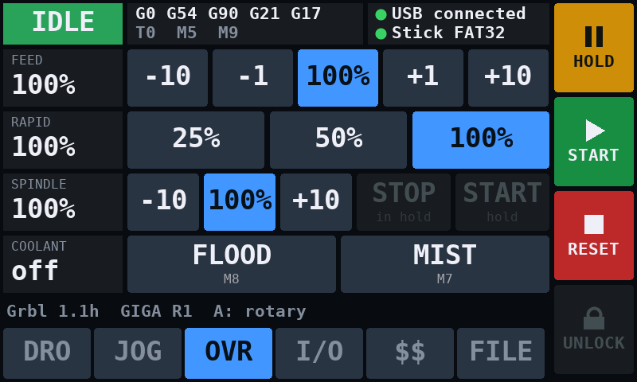 | 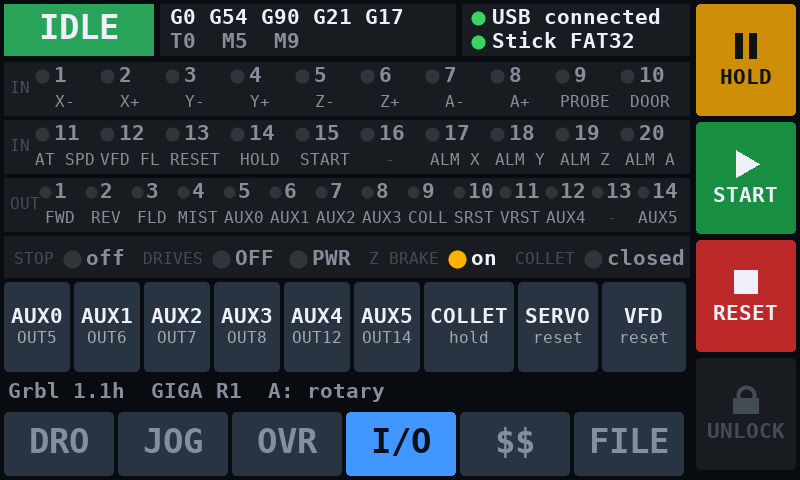 |
| **`$$`** | **`$$`, editing a setting** |
| 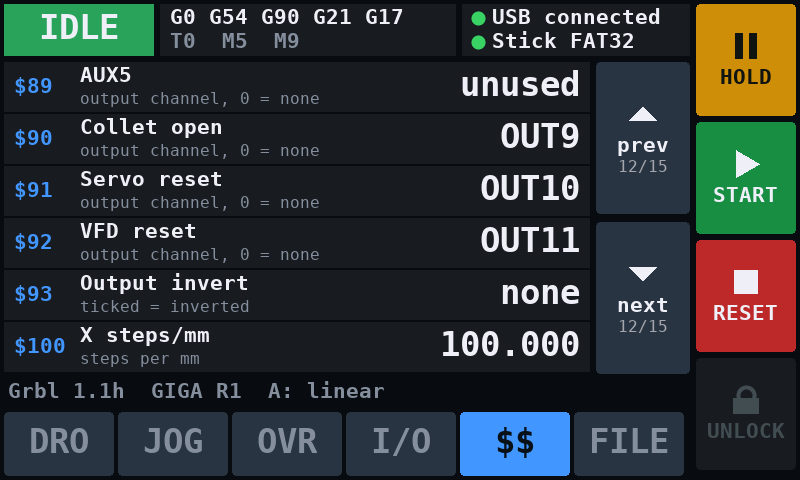 | 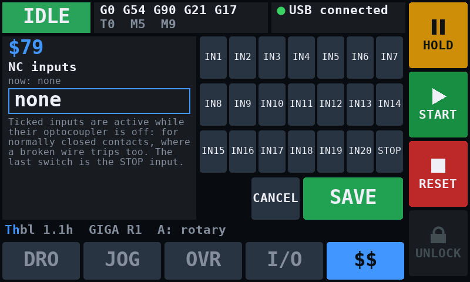 |
| **FILE** (programs from the USB stick) | **FILE**, a program running (paused) |
| 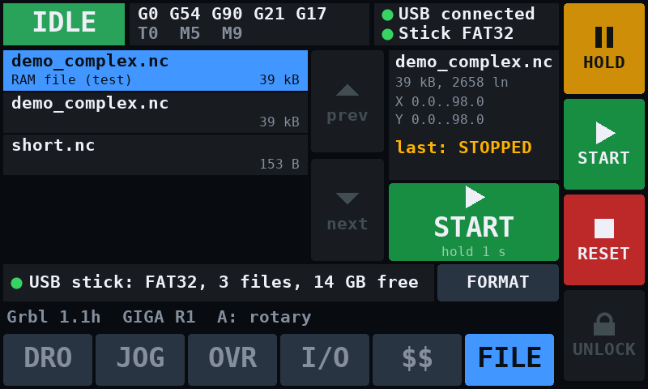 | 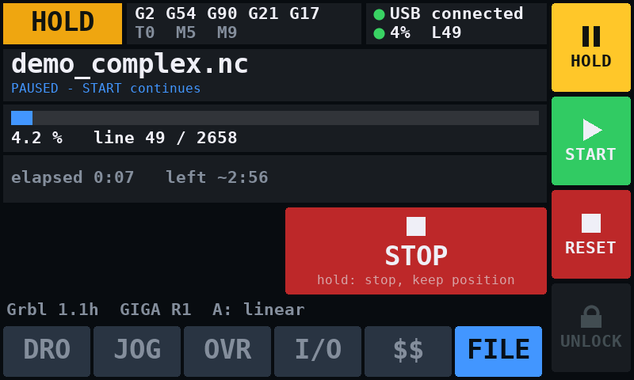 |
| **E-STOP** (after a STOP, until the reset) | **Splash** (after power-up) |
| 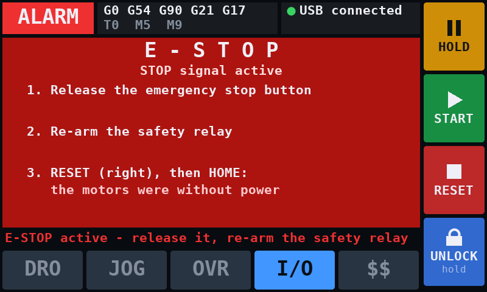 | 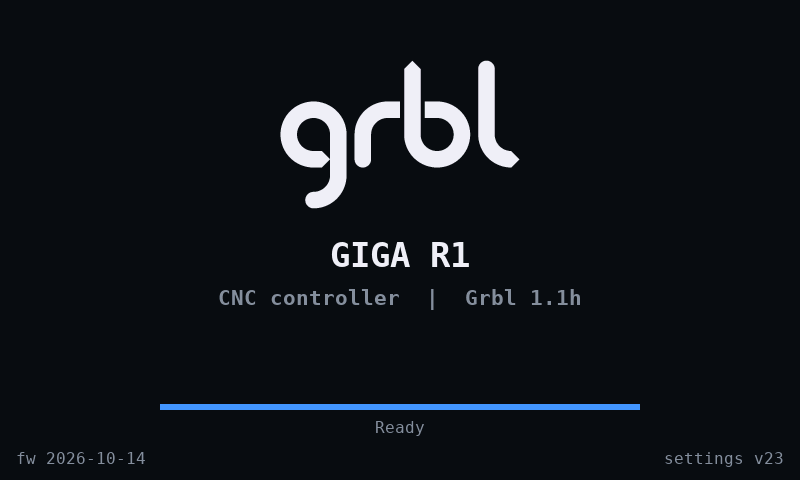 |

**Splash screen.** After power-up the display shows the Grbl logo, "GIGA
R1", a progress bar and one status line — "Starting Grbl on the M7 core...",
"Waiting for the USB stick...", "Ready" — with the firmware date and the
settings version in the corners. It stays until Grbl answers and the USB
stick has settled (at most 2.5 s more), at least 2 s, and touches are not
acted on meanwhile. The same screen, without the bar, says "Waiting for Grbl
on the M7 core..." whenever the M7 goes silent for 3 s. The logo is
`src/m4/logo.h`, made from `docs/Grbl Logo.svg` by `tools/make_logo.py`
(4-bit coverage like the fonts, drawn by `cv_bitmap4()`).

Always on screen:

* the machine **state** (Idle, Run, Hold, Jog, Homing, Alarm, Door, Check,
  Sleep) as a coloured badge; the active **modal state** (motion mode, work
  coordinate system, G90/G91, G20/G21, plane, tool, spindle and coolant
  M-codes); the USB cable to the PC (with the line number of a streamed
  program that has N words) and, below it, the USB stick: none, mounting,
  mounted (FAT32/exFAT), not mountable (NTFS, error), formatting, or the
  progress of the program running from it;
* **HOLD**, **START**, **RESET** and **UNLOCK** in the right-hand column. START
  lights up when there is something to resume; UNLOCK is live only in alarm;
* a message line with the **alarm** text, the last **error** (ten seconds),
  a hint after a touch that did nothing, or the machine configuration;
* the six page tabs.

The pages:

* **DRO** — work position of X, Y, Z, A in large digits, machine position
  beside each, in mm/inch/degrees as appropriate (a slave A row says so), an
  **X=0 … A=0** button per axis (`G10 L20 P0`), and feed and spindle with
  their overrides. The spindle line is the speed output, the direction, the
  programmed S and the PWM duty — with the VFD over RS485 (`$33`) the
  actual speed first, from the drive's output frequency (`$30`/`$37`):
  `8879 / 12000 CW  S12000` while it spins up.
* **JOG** — step size 0.01 / 0.1 / 1 / 10 mm (0.001 – 1 in when `$13=1`;
  degrees for a rotary A) or **CONT**, jog speed 5 / 10 / 25 / 50 / 100 % of
  each axis's `$11x`, the X Y Z A jog buttons, **HOME** (`$H`) and **ALL=0**,
  a compact DRO, and the handwheel's axis and step when `$96` is on.
* **OVR** — feed −10 / −1 / 100 % / +1 / +10 (the ±buttons repeat when
  held), rapid 25 / 50 / 100 %, spindle −10 / 100 % / +10, spindle **STOP**
  and **START** in a feed hold (Grbl's spindle stop override: STOP while the
  spindle runs, START held 0.5 s once STOP has stopped it; the label then
  says OFF; the cycle START also restarts it and resumes) — and while idle:
  START (held 0.5 s) runs `M3`, or `M4` if the last one was M4, with the
  programmed S, with S0 at the middle of `$31`–`$30` (`S12000` at
  `$30=24000`), STOP is `M5`; both through the parser, so the modal state
  follows and `$52` waits as for an `M3` from the PC (not in laser mode, not
  with the collet open). **FLOOD** and **MIST** toggles.
* **I/O** — IN1–IN20 and OUT1–OUT14 as indicators, each with the name of the
  function assigned to it; STOP, drives, Z brake and collet; **AUX0 – AUX5**
  as on/off buttons, **COLLET** (hold to open, tap to close) and the
  **SERVO** and **VFD reset** pulses.
* **`$$`** — all 101 settings, six to a page, each with its number, name, a
  one-line hint and its current value (masks as axis letters or channel
  numbers, choices by name). Tapping one opens an editor with a full
  explanation of what the setting does and:
  * a **keypad** for numbers and channel numbers (DEL, CLR; no decimal point
    for whole-number settings);
  * **switches** for bit masks — X Y Z A for `$2 $3 $23`, AUX0–5 for `$46`,
    IN1–IN20, STOP and PWR for `$79`, OUT1–12 for `$93`, MPos/Buffer for `$10`;
  * **choices** for on/off settings and modes (`$40` Cartesian/CoreXY,
    `$41`, `$42` rotary / linear / slave of X / slave of Y, …).

  SAVE sends `$n=value` to Grbl — only while idle or in alarm — and closes the
  editor; a value Grbl refuses (say `$0=1`, below the 3 µs minimum) leaves the
  setting alone, the editor open and the error on the message line. CANCEL,
  or the `$$` tab again, goes back to the list.

**How touches become commands.** HOLD, START, RESET, the overrides, coolant
and spindle stop are Grbl's own real-time bytes; the M4 puts them in a ring in
shared memory and the M7 feeds them into the same path as bytes from the PC,
so they act at once in every state, exactly as from a sender. The AUX buttons
switch at once too, like `M64`/`M65`, and so do COLLET and the reset pulses
(even during an `M6` pause, when Grbl parses no lines). Jog, home, unlock and
zero are
commands underneath (`$J=…`, `$H`, `$X`, `G10 L20 P0 …`); the M7 runs them
only **between two lines from the PC** — never while part of a line has
arrived — so the touch screen cannot split a line a sender is streaming. Their
`ok`/`error` goes to the display, not to the USB port, where an unexpected
reply would upset a sender's line counting. A touch command that cannot run
within 0.5 s (because Grbl is busy in a dwell, say) is dropped, not run later
at some unrelated point.

**Safety.** The touch screen is not an emergency stop — the emergency stop
is the safety relay, which cuts the power, and its signal contact on STOP
(D49, `$57=1`); while it is latched the display shows a red E-STOP banner
over the page with what to do. Within that:

* **Hold to act**: HOME and ALL=0 need the button held for 1 s, X=0 … A=0 for
  0.8 s, UNLOCK, the AUX outputs and the spindle START for 0.5 s — a bar fills while you hold. A
  brushing finger does nothing but show a hint.
* Buttons that make no sense in the current state are greyed out and do
  nothing (jog only when idle or jogging, zero only when idle, …).
* **Continuous jog** runs only while the finger stays on the button. Lifting
  it or sliding off sends Grbl's jog cancel; independently, the M7 cancels the
  jog by itself if the M4 stops confirming the finger for 300 ms (a dead man's
  switch against a hung display), and every continuous jog is planned no
  longer than 30 s and stops short of the soft limits when those are on.
  Grbl stops ~90 ms after the cancel plus the deceleration — the step
  segments already prepared run out first, as for any feed hold.
* Touches are ignored while the display has no fresh status from Grbl (for
  3 s, which a flash erase on the M7 never reaches; homing keeps the status
  coming).

**RGB LED.** The shield's RGB LED (an IS31FL3197 on the same I2C bus) lights
in the colour of the state badge: green Idle, blue Run, amber Hold, cyan Jog,
violet Homing, orange Door, grey Check; red, blinking, in Alarm; red,
blinking fast, after a STOP; off while the display has no status from Grbl.
`$I` reports `rgb=1` when it answered.

**Touch controller.** The shield's Goodix GT911 on I2C4 (Wire1, 400 kHz),
reset PI2, interrupt PI1, is polled every 10 ms by the M4. `$I` reports `touch=1/…`
when it answered at start-up, then the number of presses and where the last
one landed. `$TOUCH=x,y[,ms[,delay]]` presses the screen at landscape pixel
(x, y) for ms milliseconds — the same code path as a finger, used by
`tests/test_touch.py`.

All of it is drawn by the M4 from a snapshot the M7 writes into shared SRAM4
every 40 ms. Each panel is redrawn only when its content changed, into a
buffer in the M4's own RAM that DMA2D then copies into the framebuffer — so
nothing flickers and a still machine costs nothing.

`$SCREEN` makes Grbl send the framebuffer over USB; `tools/screenshot.py`
turns it into a PNG. That is how the pictures in this README were taken.

---

## Settings

All of upstream Grbl's settings except `$5` and `$6` (limit and probe
inversion — every input has its own bit in `$79` here), plus:

| Setting | Default | Meaning |
|---|---|---|
| `$33` | 0 | spindle VFD over RS485: 0 none, 1 Delta |
| `$34` `$35` `$36` | 1, 9600, 1 | VFD Modbus address, baud rate, frame (0 8N1, 1 8N2, 2 8E1, 3 8O1, 4 8E2, 5 8O2) |
| `$37` | 400 | VFD frequency at S = `$30` (Hz) |
| `$38` | 0 | PWM on OUT13 (D6): 0 off, 1 on, 2 inverted |
| `$39` | 1 | operator panel buttons START/HOLD/STOP (A4–A6) in use |
| `$40` | 0 | kinematics: 0 Cartesian, 1 CoreXY |
| `$41` | 0 | CoreXY limits: 0 per motor, 1 per head axis |
| `$42` | 0 | A axis: 0 rotary, 1 linear, 2 second X motor, 3 second Y motor |
| `$43` | 0 | home an independent A axis in `$H` |
| `$44` `$45` | 0, 0 | operator panel potentiometer A0 / A1: 0 none, 1 feed, 2 spindle, 3 rapid override |
| `$46` | 1 | AUX outputs that run with the spindle (mask AUX0=1 … AUX5=32) |
| `$48` `$49` `$50` | 200, 100, 200 | Z brake: drives on → released, released → first step, brake on → drives off (ms) |
| `$51` | 5000 | spindle run-down before the collet may open (ms) |
| `$52` | 0 | at-speed timeout (ms); 0 = do not wait |
| `$53` | 2 | at speed lost while cutting: 0 ignore, 1 feed hold, 2 alarm |
| `$54` | 0 | fixed wait after `M3`/`M4` without the at-speed relay (ms) |
| `$55` | 500 | servo / VFD reset pulse (ms) |
| `$56` | 0 | direction change → next step (µs, up to 1000) |
| `$57` | 0 | central STOP input in use |
| `$58` | 1 | `M6`: 0 error (upstream), 1 pause for a manual tool change |
| `$59` | 1 | Z brake: 0 the drive works it, 1 the BRAKE output |
| `$60`–`$78` | 1 … 8, 17 … 20, 9, 13, 14, 15, 10, 11, 12 | input channel of each input function (0 = not used) |
| `$79` | 0 | NC inputs: bit n−1 = INn, bit 20 = STOP, bit 21 = DRV PWR |
| `$80`–`$92` | 1 2 3 4 5 6 7 8 12 14 9 10 11 | output channel of each output function (0 = not used) |
| `$93` | 0 | inverted outputs: bit n−1 = OUTn |
| `$94` | 0 | driver power input (D53) watched |
| `$95` | 1000 | drive supply back this long before `$H`/`$X` (ms) |
| `$96` | 0 | handwheel: 0 off, 1 on, 2 on reversed |
| `$97` | 0.001 | handwheel step at x1 (mm or degrees) |
| `$98` | 3000 | highest handwheel feed (mm/min) |
| `$103` `$113` `$123` `$133` | 8.889, 3600, 360, 360 | A axis steps, rate, acceleration, travel (degrees with `$42=0`) |

The settings version changed with the I/O channels (21): the first start of
that firmware restored the defaults. Versions 22 (`$94`, `$95`), 23
(`$96`–`$98`), 24 (`$33`–`$37`) and 25 (`$38`, `$39`, `$44`, `$45`) only append
settings, and a version 21–24 record is taken over as it is (the new ones get
their defaults; a record with laser mode on keeps the PWM, `$38=1`). Older records are still
replaced by the defaults — note `$$` and `$#` before updating.

New status codes: `error:39` collet open, `40` STOP active, `41` limit switch
held in that direction, `42` channel already used, `43` VFD fault active,
`44` collet interlock, `45` no limit switch at the homing end, `50` drives
without supply (or not back for `$95` yet), `51` the VFD over RS485 is silent,
refused a command, does not follow or stopped by itself, `52` `$VFD=R/W` answered with a Modbus
exception. New alarms: `ALARM:14` spindle not at speed, `17` servo alarm,
`18` STOP, `19` VFD fault, `20` homing hit the far switch, `22` drive supply
lost, `23` VFD over RS485 silent, refusing, not following or stopped by itself.

Settings live in the STM32's internal flash, in two 128 kB sectors of bank 2
just below the M4 program (0x08140000 and 0x08160000). Each change appends a
1 kB record with a sequence number and a CRC; a sector holds 124 records, and
only when one is full is the other erased (a second or two, once every 124
changes). A record becomes valid only once it is written completely, so
losing power at any moment leaves the last good settings readable. Uploads do
not touch those sectors, so settings survive re-flashing.

---

## How it works on the GIGA

**Two cores, one sketch.** `Grbl_Giga_R1.ino` is compiled once per core. The
Grbl core and the M7 HAL are fenced with `CORE_CM7`, the display with
`CORE_CM4`; what the M4 build compiles of Grbl is never called and the linker
drops it. The cores share nothing but the block in `src/grbl_shm.h`, at
0x3800C000 in SRAM4: the M7 maps it non-cacheable through the MPU and writes
it under a sequence counter, the M4 copies it out and keeps the copy only if
the counter was even and unchanged. The M4 writes back a heartbeat, a ring of
real-time bytes from the touch screen and a one-slot mailbox for the touch
actions that are commands (see the touch screen above).

**Step generation.** mbed OS keeps a 32-bit timer for its microsecond ticker
on each core (TIM5 on the M7, TIM2 on the M4), so Grbl uses 16-bit timers:
TIM7 for the stepper interrupt, TIM6 in one-pulse mode to end each step pulse,
TIM17 for the input scan, all at 240 MHz. A step period longer than 65536
counts (below 3.7 kHz) is split into equal timer cycles by the HAL and Grbl's
interrupt runs on the last one. The pulse timer and the STOP interrupt run
at NVIC priority 0, the stepper at 1, the input scan at 2; everything else on
the M7, the USB stack included, is moved below them at start-up. (The scan
used to sit above the stepper; with twenty channels it takes 1.3 µs, and
preempting the stepper between its timer event and the step pulse merged
pulses at 200 kHz. The STOP does not need the scan, and the scan is delayed
by one stepper interrupt at most.) Interrupts run on an 8 kB stack
of their own instead of mbed's 1 kB.

**USB.** The mbed USB CDC stack calls the receive callback from its interrupt,
with interrupts masked; Grbl's callback runs right after the core's own and
hands every byte to the real-time filter, so `!` and Ctrl-X act from interrupt
context as on AVR. Output goes into an 8 kB ring that the main loop hands to
the endpoint 63 bytes at a time with the non-blocking `send_nb()` — 63 so that
every packet ends a USB transfer. Nobody reading the port does not stall
Grbl: output is discarded while no terminal has the port open, and after 3 s
of a stalled endpoint.

**mbed's critical sections.** mbed protects its data with
`core_util_critical_section_enter()`, which by default masks *every*
interrupt — and the USB device stack handles each USB event inside one. That
held the step-pulse interrupt back by up to 13 µs, enough to merge step pulses
above 100 kHz (17 in 383 000 at 100 kHz). The core declares the three hooks
behind it weak, so this port replaces them (`hal_h7.cpp`) with a version that
masks by priority (BASEPRI): all of mbed, USB included, is held off exactly as
before, while the three Grbl timers above it keep running — they never touch
mbed state. Worst pulse-timer latency since: **1 µs**, and no merged pulse in
any test. Until `hal_init()` has moved mbed's interrupts below the Grbl
timers, the hooks keep masking everything, and interrupts a driver enables
later at priority 0 are moved down within 100 ms.

**Two more traps in mbed that cost a crash each**, worth knowing for anyone
writing flash on this core: mbed's MPU makes the whole code region read-only,
so a plain `HAL_FLASH_Program()` is a MemManage fault; and the call that lifts
that protection is `mbed_mpu_manager_lock_rom_write()` — "lock" the writable
state — while `unlock` puts it back. Calling them the other way round
underflows a counter and mbed halts with the red 4-long-4-short pattern.

**Time.** mbed's `millis()` was measured running 4 % slow against the PC on
this board (while step rates timed by the PC are exact to 0.1 %, so the core
clock is right); `hal_millis()` therefore counts CPU cycles instead.

**Smaller changes to upstream behaviour.** A status report requested in the
same USB packet as `!` or `~` reports the state that command produced
(upstream prints it before handling them, which only worked because a UART
let the main loop run between the two characters). Status requests are
answered during a critical alarm ("Reset to continue"), as upstream's comment
there says they should be. The tool number `T` is kept from one block to the
next (upstream reset it to 0 on every block without a T word, so `$G` showed
T0). `M5` releases both FWD and REV. `$I` is answered in every state (it
only reads), so its diagnostics can be watched during motion.

**Homing keeps the link alive.** Upstream's homing loop services nothing
("no time to run protocol_execute_realtime()"). On AVR the UART interrupt
still took `?` and Ctrl-X; here the USB output, the display and the touch
screen's commands all live in the main loop, so for the whole switch search -
up to 1.5 × `$13x` at `$25`, 36 s per axis with the default settings and no
switch connected - the PC heard nothing, the display fell back to "waiting
for Grbl" and its RESET was not read. The loop now pumps the link and the
display and answers `?` (state `Home`) every pass; a reset from the PC, the
touch screen or the reset input ends homing with `ALARM:6` as upstream's does.

---

## Layout

```
Grbl_Giga_R1.ino         one sketch, two cores: Grbl on the M7, display on the M4
build.sh                 builds and uploads both cores
PLAN.md                  development plan, shield requirements (Slovak)
PINOUT.md                pin table of the peripheral shield (Slovak)
src/
  grbl_main.c            upstream main.c, split into grbl_init()/grbl_loop()
  config.h defaults.h    build options and machine profiles
  cpu_map.h              pin assignment
  kinematics.[ch]        Cartesian / CoreXY, A axis modes
  io.[ch]                IN1-IN20 / OUT1-OUT12 channels, function assignment, $TIN/$TSW
  outputs.[ch]           output functions, M62-M65, $46, collet, reset pulses
  estop.[ch]             central STOP (EXTI4)
  display.[ch]           the M7 side of the display: status snapshot, touch commands, $SCREEN, $TOUCH, $SPLASH
  jog.[ch]               jog commands: the sender's $J=, the touch screen's, the handwheel's
  drvpwr.[ch]            driver power input (D53), ALARM:22
  mpg.[ch]               handwheel pendant: TIM8 wheel, selectors, LED
  vfd.[ch]               spindle VFD over RS485: Modbus RTU master, Delta profile, $VFD, $TVFD
  panel.[ch]             operator panel: START/HOLD/STOP buttons, override potentiometers, $TPNL, $TPOT
  job.[ch]               programs from the USB stick: check pass, run, STOP, $F commands
  grbl_job.h             shared block for the USB stick: file listing, requests, the line ring
  grbl_shm.h             shared memory layout between the cores
  platform.h             AVR compatibility shims
  planner.c gcode.c stepper.c limits.c ...   Grbl core, four axes
  hal/
    hal.h                the platform interface the C core sees
    hal_h7.cpp           GPIO, TIM6/7/17, TIM4 PWM, DAC, TIM8 handwheel, USART2 RS485, delays, LEDs
    hal_serial.cpp       USB CDC transport
    hal_nvs.cpp          settings log in internal flash
    hal_shm.cpp          shared memory, starting the M4
  m4/
    gui.cpp              the status display and touch panel (runs on the M4)
    usbstick.[ch]        the USB stick: host thread, listing, streaming, writing, formatting
    usbhost/             USB host stack (from Arduino_USBHostMbed5 0.3.1, M4 build)
    fatfs/               ChaN's FatFs R0.15: FAT and exFAT, MBR and GPT (M4 build)
    touch.[ch]           GT911 touch controller, RGB LED
    canvas.[ch]          drawing: scratch buffer + DMA2D, anti-aliased text
    fonts.h              generated by tools/gen_fonts.py (DejaVu Sans Mono)
    logo.h               generated by tools/make_logo.py (the splash screen's Grbl logo)
tools/
  gen_fonts.py           renders the display fonts
  make_logo.py           rasterizes docs/Grbl Logo.svg for the splash screen
  screenshot.py          saves the display as a PNG via $SCREEN
  fastbuild.py           incremental rebuild from a verbose arduino-cli log (development aid)
  usbfiles.py            files onto the USB stick in the GIGA from the PC: ls, put, rm, sync, format
tests/
  grbl_link.py           pyserial helper shared by the scripts below
  test_comm.py           link: banner, integrity, latency, real-time commands, throughput, soak
  test_steprate.py       step rate accuracy, ceiling, pulse counts, scan coverage
  scope_step.py          STEP pin on a Tektronix MDO3034: rate, pulse width, ramp, against $0/$100/$110/$120
  scope_dir.py           STEP and DIR on the scope: direction setup and hold at fast reversals, $56
  test_stream.py         g-code streaming: ramp, feed hold, sustained load
  test_axes.py           A axis modes, slave pulses, outputs, M62-M65, servo alarm
  test_io.py             assignment, limits +/-, homing, STOP, spindle relays and the resume of a hold, collet, M6,
                         brake, $56, driver power
  test_job.py            programs from the USB stick (one must be in): check pass, M0, M6, errors,
                         STOP, rate, names with spaces, read-back
  usbjob.py              puts test files onto the stick as zz_<name> ($FW) and removes them, lists ($F)
  test_corexy.py         CoreXY: belt motor pulses, closure, feed rate, $41, exclusions
  test_touch.py          every touch button and the $$ editor via $TOUCH, screenshots (--shots)
  test_mpg.py            handwheel: steps, OFF/blocked, following the wheel, dropped excess, axis change, soft limits
  test_panel.py          OUT13/OUT14, the PWM on OUT13 ($38), panel buttons and potentiometers
  test_vfd.py            spindle VFD over RS485: M3/M4/M5/S, at speed, fault, silent / refusing / keypad drive,
                         its keypad STOP, the resume of a hold, $VFD; simulated ($TVFD) or the PC as the drive
                         on a USB-RS485 adapter (--rs485)
  test_vfd_drive.py      a real Delta drive on the RS485 port (no motor): M3/M4/M5, S, override, $52 with
                         reversal, the OVR page's spindle START/STOP; --manual: its keypad STOP, the cable pulled; --motion: the resume of a hold
                         and of the door waits for the drive ($52, $54)
  demo_run.py            streams examples/demo_complex.nc and times it
examples/                demo g-code; usb/ - test files for a stick
docs/*.png               screenshots of the display ($SCREEN)
docs/scope/              oscilloscope plots of STEP and DIR
hardware/Grbl_Giga_Shield/   shield mechanics from Arduino's CAD files, layout concept (Slovak)
```

---

## Verification

Measured on an Arduino GIGA R1 WiFi with the GIGA Display Shield, over native
USB from a Windows 11 PC, with the scripts in `tests/` (Python 3 + pyserial).
No motors attached: the machine position in the status reports is the stepper
interrupt's own step counter, so sampling it against the PC's clock measures
the step rate the interrupt produced; `$I` counts stepper interrupts, pulse
terminations, the pulses each driver got (signed by direction) and input
scans, and reads back the PWM and DAC registers. The numbers below are from
the final firmware, touch panel and CoreXY included.

**Step rate accuracy** (`test_steprate.py`), 100 steps/mm, commanded against
measured — all four AMASS levels, and below 3.7 kHz the HAL's stretched 16-bit
timer periods:

| Commanded steps/s | 100 | 250 | 500 | 1000 | 2000 | 4000 | 8000 | 16000 | 4000 @ 400 steps/mm |
|---|---|---|---|---|---|---|---|---|---|
| Measured | 100 | 250 | 500 | 1000 | 2000 | 4001 | 8000 | 16005 | 4000 |

**Step rate ceiling**, 250 steps/mm, `$0=3`; the last column is pulse
terminations against stepper interrupts for the same move (equal means no
pulse was merged with the next):

| Commanded | 1 axis | X+Y+Z+A together | pulses / ticks (4 axes) |
|---|---|---|---|
| 10000 | 10001 | 10002 | 37279 / 37279 |
| 50000 | 50014 | 50018 | 188425 / 188425 |
| 100000 | 100016 | 100026 | 383417 / 383417 |
| 150000 | 150008 | 149973 | 585126 / 585126 |
| 200000 | 199999 | 200059 | 793425 / 793425 |
| 250000 | 200067 (clamped) | 200053 (clamped) | 1008417 / 1008417 |
| 300000 | 200015 (clamped) | 200036 (clamped) | 1230126 / 1230126 |

Exact to **200 kHz on all four axes at once**, where `MINIMUM_STEP_CYCLES`
caps it on purpose; over the run 10.11 million stepper interrupts and as many
pulse terminations, **0 merged pulses**, worst stepper interrupt latency
**1 µs**. (The UNO Q port tops out at 100 kHz, the R4 at 84 kHz on one axis,
AVR Grbl around 30 kHz.) The input scan keeps its 10 kHz — 100 % coverage at
200 kHz × 4 axes — although it now sits just below the stepper interrupt;
`$I isr=` reports its longest run, 1.3 µs with twenty channels at rest.

**On the oscilloscope** (`tests/scope_step.py`: Tektronix MDO3034, CH1 on
STEP X; a whole move recorded with 10M points, then the scope's own
measurements during the cruise; plots and screenshots in `docs/scope/`):

| `$0` | `$100` | `$110` | asked | expected | measured (mean of the cruise) | steps | pulse | gap |
|---|---|---|---|---|---|---|---|---|
| 10 µs | 250 | 500 | 2083.3 Hz | 2083.3 Hz | 2083.6 Hz, periods 480 ± 1 µs | 12500 / 12500 | 10.38 µs | 469.6 µs |
| 10 µs | 1000 | 12000 | 200 kHz | 83.33 kHz (period ≥ `$0` + 2 µs) | 83.342 kHz | 100000 / 100000 | 10.37 µs | 1.64 µs |
| 3 µs | 1000 | 12000 | 200 kHz | 200 kHz | 200.020 kHz | 100000 / 100000 | 3.37 µs | 1.63 µs |
| 3 µs | 1000 | 15000 | 250 kHz | 200 kHz (`MINIMUM_STEP_CYCLES`) | 200.022 kHz | 100000 / 100000 | 3.37 µs | 1.63 µs |

* The rate is the one asked for, or the ceiling: 5 µs (200 kHz), and
  `$0` + 2 µs — at the default `$0=10` the ceiling is 83.3 kHz. All the
  measured rates sit 0.010 % high, the GIGA's crystal against the scope's.
* The pulse is `$0` + 0.37 µs, always: the pulse-off interrupt's entry and
  the timer and GPIO writes before it. Never shorter than `$0`.
* The acceleration measured from the ramps: 10.02 and 995 mm/s² for `$120` 10
  and 1000 (999.9 with 2 ms segments, below). On the ramps a single step can
  come early or late where a new segment starts or where AMASS changes level
  (2, 4 and 8 kHz) — up to ±60 µs at 2 kHz, as in AVR Grbl.
* **The ramp is a staircase**, one stair per step segment — that is how Grbl
  makes acceleration: each segment runs at one rate. Upstream's 100 segments
  a second (10 ms) made 10 kHz stairs at 1000 mm/s² and 1000 steps/mm; the
  port now runs **500 a second (2 ms) → 2 kHz stairs**
  (`ACCELERATION_TICKS_PER_SECOND`, with `SEGMENT_BUFFER_SIZE` 50 so the
  buffer still holds ~100 ms of motion):
  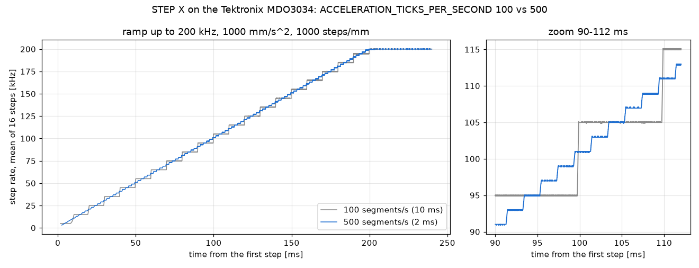
  Measuring this turned up a fault the shorter segments brought out. Below
  about 460 steps/s the step period is longer than the 16-bit timer, and the
  HAL counts it in several timer cycles; about once per segment load the
  timer interrupt came a second time without an update (its flag not yet
  cleared in the timer when the handler ended), and counted as a cycle it
  made the next step come one cycle early — 100 steps/s ran at **101.8**,
  250 at 254.2. The handler now ignores an entry without the update flag
  (`$I spur=` counts them): **100.013 and 250.030 Hz**, every period within
  1 µs of 10 and 4 ms.
  At exactly 200 kHz the cruise measures 0.01–0.05 % slow (5000.5–5002.6 ns
  over 8 ms windows): Grbl rounds each segment's step period up to whole
  4.17 ns timer ticks, and with 2 ms segments more of them land on 1201 than
  on 1200. Where segments meet, one period is up to ±125 ns off and the next
  one evens it out; the steps and the geometry are exact.
* Edges 1.1 ns, 0.04 / 3.25 V; the ±52 % overshoot is mostly the probe's
  ground lead at such edges (a slower GPIO speed would do for the shield).
* **DIR against STEP** (`tests/scope_dir.py`, CH2 on DIR X; a zigzag of 20
  sharp corners where X reverses at 50–100 kHz, `$0=3`, 1000 steps/mm):
  with `$56=0` DIR changes **203 ns** before the step's rising edge (both in
  the same interrupt, DIR first); with `$56=35` the first step after each
  change comes **35.4–35.6 µs** after it, the one after that 6.5 µs later
  (still above the 5 µs floor), then the rest as planned. DIR never changed
  while a pulse was high — at least 6.6 µs after the last falling edge — and
  the 40 000 steps were all there both times.

**Link** (`test_comm.py`): `?` round trip **0.21 ms median** (p95 0.33 ms,
max 0.41 ms, 4818 reports/s); `!` shows `Hold` and `~` is back to `Idle`
within **0.3 ms**. Comment lines with character counting: **9850 lines/s**
(128 kB/s) with a 127-byte window, 9130 with 500 bytes. 30 s soak with 50 ms
polling: **270 848 lines, 270 848 ok, 0 errors, 0 malformed frames** (an
earlier 60 s soak: 535 012 lines, 0 errors). `$$` and `$I` 20 times
byte-identical; settings survive a soft reset.

**G-code under motion** (`test_stream.py`), 250 steps/mm, 300 segments per
row, every line acknowledged and the final position exact to the step:

| Segment | Feed | steps/s | lines/s |
|---|---|---|---|
| 0.50 mm | 2400 | 10000 | 93 |
| 0.50 mm | 9600 | 40000 | 168 |
| 0.20 mm | 12000 | 50000 | 417 |
| 0.10 mm | 12000 | 50000 | 767 |
| 0.05 mm | 12000 | 50000 | 1282 |

The planner, not the link, sets these: each segment has to be accelerated
into and out of. Feed hold 1.5 s into a 400-line stream, resume 3 s later:
`Run → Hold:1 → Hold:0 → Run`, 400/400 ok, final position exact. 120 s of
0.15 mm segments at F5400 with 50 ms polling: **59 686 lines, 0 errors**,
2 587 936 stepper interrupts = 2 587 936 pulse terminations (30 s with the
final firmware: 14 953 lines, 0 errors, no merged pulse).

**The example program** `examples/demo_complex.nc` (2595 lines: arcs,
helices, a 720-segment spiral, a 1786-line raster) streamed like a sender:
**152.9 s, 2595 ok** — the same as on the UNO Q, i.e. the machine's
acceleration limits, not the controller.

**Fourth axis, outputs, alarms** (`test_axes.py`), all passing:

* `$42=0`: `G0 A90` → A 90; `G20 G1 A45` → A 45 (degrees are not scaled); a
  full `G2` circle with `A0→180` ends at A 180.000 exactly.
* `$42=1`: `G20 G1 A1` → A 25.4 mm.
* `$42=2` / `3`: `G1 A10` refused with `error:20`; `G1 X10` (or `Y10`) at
  100 steps/mm puts out exactly **1000 pulses on the A driver** while A reports
  0; a Z move adds none.
* `M3` → OUT1 FWD + OUT5 (AUX0 follows the spindle), `M4` → OUT2 REV with
  FWD off, `M5` all off; `M7`/`M8` → OUT4/OUT3; `M64 P1`, `M64 P3` → OUT6,
  OUT8; `M65 P1` + `M62 P2` after a move → OUT7 + OUT8; `M64 P4` → OUT12;
  `M64 P5` switches AUX5 on with no channel assigned; `M64 P6` refused;
  `$93=4095` inverts the pins without changing the logical state; `$84=11`
  refused (`error:42`, OUT11 is the VFD reset) until `$92=0`, then AUX0 runs
  on OUT11; `M2` switches everything off.
* `S12000` with `$30=24000`: PWM read back from TIM4 50.0 %, DAC 2047;
  `S6000`: 25.0 %, 1023; `M5`: 0, 0.
* IN9 (servo alarm X) pulled active with `$TIN=9,1`: **ALARM:17** at once,
  `Pn:M` in the status; the reset after it puts a `$55` pulse on OUT10 (servo
  reset), gone after `$55`; released and `$X`: Idle.

**I/O channels, limits, STOP, spindle, brake** (`test_io.py`), all passing:

* Assignment: X+ onto Y−'s input refused (`error:42`), X+ onto X−'s accepted
  (switches in series), `$60=21` and `$79` with bit 22 refused, `$5` gone;
  `$79=1` makes the idle IN1 read active.
* Limits, `$21=1`: X− closes → `ALARM:1` `[MSG:Limit X-]`; after the reset
  still Alarm (`Check Limits`) and `Pn:X`; jog further into X− refused
  (`error:41`), jog away 2 mm with the switch held: Idle; `G1` back into it:
  `ALARM:1`. Two switches on one input: `[MSG:Limit X]`, and the axis may move
  either way. Minus switch only: the same rules as two inputs. A virtual X+
  switch at 3 mm hit by `G1 X10`: `[MSG:Limit X+]`.
* Homing on virtual switches 5 mm out (`$TSW`), `$23=0`: `$H` done in 6.4 s,
  machine position −1, −1, −1 (the pull-off); the Z− switch placed at the
  plus end closes while homing towards Z+: `ALARM:20`; `$65=0` (no Z+):
  `$H` refused with `error:45`.
* STOP during a move with spindle and flood on: `ALARM:18` `[MSG:E-stop]`,
  `Pn:E`, not one step after the trip, tripped by its interrupt in a
  **10.6 µs** routine; outputs, enable and brake off; `$X` refused (`error:40`)
  while active and after release until the reset; then `$X` ok. STOP already
  active when `$57` is switched on: found by the scan.
* Driver power, `$94=1`, `$95=500`, the supply simulated with `$TIN=22`: lost
  during a move → `ALARM:22`, not one step after it, enable and brake off;
  `$X` and `$H` → `error:50`; back → `$X` still refused until `$95` is over,
  then `[MSG:Driver power on]` and `$X` ok; lost while idle with the drives
  holding (`$1=255`, brake released) → `ALARM:22`, brake on, drives off; lost
  again while in that alarm → `ALARM:22` without a reset; lost while homing →
  `ALARM:22` (not `ALARM:6`); `$94=1` without supply → `ALARM:22`; bit 21 of
  `$79` inverts the input; `$94=0` ignores it again. The board started with
  `$94=1` and nothing on D53: Alarm, `drv=1/1`, `$X` refused.

**Handwheel** (`test_mpg.py`, 1000 steps/mm, the wheel turned by `$TMPW`
through TIM8), all passing:

* x1, 100 detents: X +0.1000 mm; x10, −50: −0.5000; x100, 20: +2.0000;
  `$96=2`: +10 detents at x10 → Y −0.1000; axis 4 = rotary A, x100, 15
  detents: +1.5000°; `$97=0.005`, x10, 7 detents: Z +0.3500.
* Nothing moves with `$96=0`, at OFF or in check mode (state "blocked", LED
  blinking).
* 200 detents at 100/s with x100: the axis runs at 10.00 mm/s like the wheel,
  all 20.0000 mm arrive, Idle 140 ms after the wheel stops (the status
  polling included).
* 200 detents at 1000/s (100 mm/s) with `$98=1200` (20 mm/s): 4.000 mm move
  — only what the axis could follow — and Idle 134 ms after the wheel.
* X to Y in the middle of a turn: X stops at once, the rest of the turn
  moves Y; OFF stops Y at once.
* After `$H` and `$20=1` (travel 10 mm): the wheel stops X at −0.0010 and
  −9.9990, at the soft limits.
* Spindle, `$52=1500`: no relay → `ALARM:14` after 1.50 s with FWD/REV off;
  relay closed → `M3` done at once; `S800` while running waits out the 250 ms
  settle (0.250 s); relay lost while cutting with `$53=1` → `Hold:0`, START
  after it is back → Run; `$53=2` → alarm after a controlled stop; VFD fault →
  `ALARM:19`, FWD/REV off, `$X` refused (`error:43`) with the VFD reset pulse
  on OUT11, fault gone → `$X` ok.
* Collet, `$51=300`: open refused while the spindle runs and right after
  `M5`, accepted after the run-down (OUT9); `M3` while open → `error:39`; open
  while moving → `error:44`. `T3 M6`: `[MSG:Tool change T3, cycle start to
  resume]`, `Hold:0`, START resumes, the spindle stays off.
* Brake, `$48/$49/$50` = 200/100/200, `$1=25`: drives enabled at 1 ms, brake
  released at 201 ms, first step at 302 ms; after the move brake on at 26 ms,
  drives off at 225 ms. `$59=0`: BRAKE never on, first step 301 ms after the
  enable, drives off at 26 ms.
* `$56`, 40 sharp zigzag corners at 30 m/min, 1000 steps/mm, 3 µs pulses:
  without it the step follows the direction change in the same interrupt
  (0.0 µs); with `$56=35` 39 steps were held back and the shortest
  direction-to-step time was **35.4 µs**; 0 merged pulses and the travel
  exact to the step both times.

**Spindle VFD over RS485** (`test_vfd.py`, the simulated Delta drive of
`$TVFD`, which gets the frames the port would send; `$30=24000`, `$37=400`),
all passing:

* `M3 S12000` → FWD 200.00 Hz at the drive; `M4 S6000` → REV 100.00; the
  override +10 % → 110.00 at the drive; `S100` with `$31=6000` → 100.00;
  `S30000` → 400.00; `S0` and `M5` → stop, output down to 0; no failed
  transaction, `remote=3`.
* `$52=5000`: `M3 S24000` (the drive ramps at 400 Hz/s) answers ok after
  1.05 s with `at=1`; `S12000` after 0.60 s (the 250 ms settle included);
  `$52=500` → `ALARM:14`, the drive told to stop.
* A hold with the spindle stopped in it (`$52=5000`): the cycle START
  resumes the move after 0.61 s, with the drive at 200.00 Hz; with the
  spindle started first (the OVR page's START): after 0.46 s.
* Drive error 7 → `ALARM:19`; `$X` → `error:43` while the cause lasts; once
  it is gone `$X` sends the fault reset, the error clears, `$X` ok.
* Silent drive: spindle off → `link=LOST`, no alarm; `M3` → `ALARM:23`, `$X`
  ok (no run command went out); running → `ALARM:23` after 0.46 s, `$X` →
  `error:51` until the drive answers and stops. During `G1 X50 F600`: Run →
  Hold → `ALARM:23` at X=14.92, position kept.
* Every second answer with a bad CRC: 13 retries, no failed transaction, no
  alarm. A drive that ignores run (keypad): `ALARM:23` after 1.07 s,
  `remote=0`. 650 Hz refused with exception 3 → `ALARM:23`, `$X` ok after
  `$37=400`. Its keypad STOP while it runs (`$TVFD=6`): `ALARM:23` after
  0.10 s, the drive not started again; `$X` and `M3` run it again.
* `$VFD=R2100,4` → `0000,0503,4E20,4E20`; `$VFD=W2001,1388`; an unknown
  register → `[MSG:VFD exception 2]`, `error:52`. The collet is refused while
  the drive runs down and opens once it stands; `$32=1` with `$33=1` →
  `error:5`; `$34` while the spindle runs → `error:8`.
* With `$33=0` the `spindle` and `collet` groups of `test_io.py` pass
  unchanged (relays, 0–10 V). The settings of version 23 were taken over.
  The real USART2 sent, timed out and retried with nothing connected (the
  transmit-complete interrupt drops D17); answers over the wire need a drive
  or `--rs485` with a USB-RS485 adapter.

**With a real drive** (`test_vfd_drive.py`, a Delta VFD-E without a motor on
the RS485 port, 9600 8N2; `01-00` = 60 Hz, so the test runs with `$37=60`;
ramps 0.1 s), all passing:

* Idle: 30 transactions in 3 s, no retry, `remote=3`; `$VFD=R2100,4` agrees
  with `$VFD`; `09-00`–`09-04` read back as 1, 1, 3, 30, 3.
* `M3 S12000` → FWD 30.00 Hz, at speed after 0.3 s; the override +10 % →
  33.00 and back; `S6000` → 15.00; `M4` → REV 15.00; `M5` → output 0 after
  0.2 s. 66 transactions, no retry, no exception.
* `$52=60000`: `M4 S12000`, then `M3` (reversed at the same speed), then
  `M3 S24000` — each ok after 0.25 s with the drive at speed in the new
  direction. Before, the reversal answered at once with the drive still in
  REV: the at-speed signal of the old direction ended the wait. A reversal
  now waits out the 250 ms settle like an S change, and a Delta drive that
  reports a direction change (2101H bits 4-3 01 or 10) is not at speed
  (`test_io.py`: with the relay, 0.25 s too).
* The drive's keypad STOP while it runs: Grbl used to repeat the run command
  and the drive ran again within 0.6 s. Now `ALARM:23` at once, the drive
  stays stopped; `M5`, `$X` and Grbl goes on.
* The RS485 cable pulled while running: `link=LOST`, `ALARM:23`, `$X` →
  `error:51`; plugged back in, Grbl stops the drive and `$X` is ok. 10 failed
  transactions while it was out.
* The other suites with the link running (`$33=1`, the drive polled every
  100 ms throughout): `test_touch.py`, `test_io.py` (without `spindle` and
  `collet`, which are for the relays and pass with `$33=0`), `test_axes.py`,
  `test_panel.py` (`pwm` with `$33=0`: laser mode and `$33` exclude each
  other), `test_steprate.py` (the same numbers: exact to 200 kHz on four
  axes, the input scan at 100 %), `test_stream.py`, `test_comm.py`,
  `test_mpg.py` and `test_corexy.py` all pass; 4429 transactions since the
  start, no retry, no failure.
* `--motion`, ramps 10 s for 0–400 Hz (`01-09`/`01-10`, `01-00`=400 Hz, so
  40 Hz/s): `M3 S12000` ok after 5.1 s, the reversal REV → FWD at 200 Hz
  after 9.9 s. A hold, the spindle stopped in it, the cycle START: X moves
  after 5.05 s with the drive at 197.5 of 200 Hz — before, after 0.02 s at
  0 Hz. The spindle started first (START on the OVR page): 4.83 s, the
  drive at 197.6 Hz. The safety door (IN9, through `$TIN`) opened and
  closed: 5.04 s, 197.5 Hz. `$52=0`, `$54=3000`: 3.02 s. 1347 transactions,
  no retry. `test_io.py` `resume` with the relay: the cycle START at 1.2 s,
  the relay back at 2.5 s → X moves at 2.53 s; the relay never back →
  `ALARM:14` after `$52`, X kept.
* The DRO page's spindle line with the drive spinning up:
  `8879 / 12000 CW  S12000`, at speed `12000 / 12000 CW  S12000`.

**Shield v4: OUT13/OUT14, the PWM on OUT13, the operator panel**
(`test_panel.py`, the panel through `$TPNL` / `$TPOT`), all passing:

* AUX4 on OUT13: `M64 P4` → OUT13 on, D6 high, `M65 P4` off; AUX5 on OUT14
  likewise; `$88=15` and bit 14 of `$93` → `error:3`; `$93=4096` inverts D6.
* `$38=1` refused while a function is on OUT13 (`error:42`), and a function
  onto OUT13 while it is the PWM; `M3 S500` → PWM 500 ‰, DAC 2047; D6 low at
  S0 and high at full duty, `$38=2` the other way round; `$38=0` → PWM off,
  the DAC still at 2047; laser mode refused without the PWM (`error:17`), as
  is `$38=0` in laser mode.
* From the panel during `G1 X50 F600`: HOLD → Hold, standing; START → Run.
  STOP while moving: `[MSG:Panel STOP]`, hold, reset to Idle without an
  alarm at X=38.82, spindle off — and a `G1 X0` afterwards lands exactly on 0
  (position kept). STOP standing with the spindle on: off, Idle. `$39=0`
  ignores the buttons.
* Potentiometers: middle → 100 %; A0 at 0 / 4095 / 1024 → feed 10 / 200 /
  57 %; A1 at 3000 → spindle 144 %; the PC's +10 % (154 %) stays while the
  knob rests, and when it moves less than the dead band; turned → 149 %;
  after a reset they set 10 % and 149 % again; `$44=3`: rapid 25 / 50 /
  100 %.
* On the same firmware `test_io.py`, `test_axes.py` and `test_vfd.py` pass;
  a version 24 settings record was taken over, the board's own I/O
  assignment kept.

**CoreXY** (`test_corexy.py`, 100 steps/mm, `$40=1`), all passing — pulses
counted per driver by `$I motor=`:

| Move | X driver (A) | Y driver (B) |
|---|---|---|
| `G1 X10` | +1000 | +1000 |
| `G1 Y10` | +1000 | −1000 |
| `G1 X0 Y0` from X10 Y10 | −2000 | 0 |
| `G1 X10 Y-10` from 0,0 | 0 | +2000 |
| two full circles (`G2`, `G3`) | net 0 | net 0 |
| `$J=G91 X5 Y5` | +1000 | 0 |

The status reports the head at X10 Y−10 after the fourth move; Z and A
moves produce Z and A pulses only. Timing, at `$110=6000` (100 mm/s) and
`$120=1000`:

| Move | Measured | Expected | Upstream CoreXY |
|---|---|---|---|
| `G1 X60 F3600` | 1.078 s | 1.060 s | 1.457 s |
| 60 mm diagonal at F3600 | 1.109 s | 1.085 s | 1.474 s |
| `G0 X100 Y100`, `$41=0` (motor limits) | 2.125 s | 2.100 s | |
| `G0 X100 Y100`, `$41=1` (head limits) | 1.125 s | 1.100 s | |

(the constant +20 ms is the PC's status polling). `$40=1` with a slave A and
`$42=2` with CoreXY are both refused with `error:5`.

**Touch screen** (`test_touch.py`, through `$TOUCH`), all passing:

* HOLD during a move → `Hold:0`; START → `Run`; RESET while moving →
  `ALARM:3`; UNLOCK tapped briefly → still Alarm, held 0.8 s → Idle.
* Step jogs X+, Y−, Z+, A− of 1 mm move exactly 1.000; three taps at 0.01 mm
  move 0.030.
* Continuous jog at 25 % (25 mm/s) held 1 s: 27.8 mm, Idle 0.19 s after the
  finger lifts, then stays put; at 100 % (100 mm/s) held 0.5 s: 60 mm.
* Y=0 tapped briefly: no change; X=0 held: G54 X = 12.5; ALL=0 held: G54 =
  12.5, −3, 4, 7.
* Feed +10, −10 twice, 100 %; +1 held 1 s → 105 % (auto-repeat); rapid 25 %;
  spindle +10; FLOOD and MIST toggle OUT3 and OUT4.
* Spindle START while idle: tapped briefly → still `M5`; held with S0 →
  `M3 S12000` (half of `$31`–`$30`), the spindle on; STOP → `M5`; held with
  `S1000` → `M3 S1000`. With the VFD-E and `$52=30000` (`test_vfd_drive.py`
  `touch`): START waits 5.6 s for the drive; STOP 1.5 s into the spin-up
  ends the wait, `M5` 0.06 s later, the drive at 57.7 Hz told to stop.
* `M3` and a move held (`!`): spindle STOP → `A:` without S, still
  `Hold:0`; STOP again and START tapped briefly: still off; START held 0.7 s:
  the spindle on again, still held; `~` finishes the move.
* AUX1 tapped briefly: off; held: OUT6 on; held again: off.
* COLLET tapped briefly: stays closed; held: OUT9 on, `M3` refused; tapped:
  closed. In a `T5 M6` pause (presses queued before, since Grbl reads no line
  then): COLLET held opens it, START is refused while it is open, a tap
  closes it, START resumes.
* A zero held during a 2 s `G4` (Grbl reports Idle, but is in the parser) is
  dropped, not run after the dwell; jog in alarm does nothing.
* Not one `ok` or `error` reached the USB port for a touch action.
* `$$` page: `$0` typed 12 and saved → `$0=12`; `$0=1` refused by Grbl, `$0`
  unchanged; `$110` typed 12345, DEL, .5 → `$110=1234.5`; `$3` with X and Z
  switched on → `$3=5`; `$42` choice "linear" → `$42=1`; CANCEL changes
  nothing; `$79` with IN1, STOP and PWR ticked → `$79=3145729`; `$95` typed
  750 → `$95=750`; `$90=4` (OUT4 is
  the mist) refused by Grbl.
* The RGB LED driver answers on I2C (`rgb=1`).
* HOME with homing on and no switch connected: `?` keeps answering `Home`
  throughout the search, and RESET on the screen 4 s into it ends homing with
  `ALARM:6`. (Before the fix: no answer at all, and the touch RESET ignored
  until the search gave up with `ALARM:9`.)

The GT911 answers at 0x5D and reports a 480 × 800 (portrait) configuration,
which the M4 rotates the same way as the picture; with a finger the tabs land
where they are touched.

A bug only real fingers showed: the M7 drops touch commands older than
0.5 s, measuring age as M4 time now minus the request's time stamp. A real
press reads the GT911 over I2C before it stamps the request, so the stamp
could be a millisecond *later* than the M4 time the M7 compared it with —
negative, which an unsigned comparison took for very old. Every jog, zero and
unlock from a finger was dropped with `error:8`; simulated presses skip the
I2C transfer and passed. Now the age is signed, and simulated presses read
the panel too. Reproduced on the bench with the I2C bus back at its old
100 kHz: 0 of 10 step jogs moved before the fix, 10 of 10 after.

**Settings** survive a re-upload of the M7 program and a reset; the banner
reports `nvs=1`.

**Display:** 25 updates a second from the M4 while the M7 streams at full
rate; all the numbers above were measured with the display running.

**Programs from the USB stick** (`test_job.py`, its files uploaded onto the
stick), all passing:

* `short.nc` (11 lines): check pass, 11 lines, range X 0..10 Y 0..10; the
  run pauses at `M0`, START resumes, it ends at 0,0. Run again: no check pass;
  written again: checked again.
* `error_l7.nc`: refused in the check pass with `error:20` in line 7, nothing
  moved, `$G` shows the G91 set before the start.
* `toolchange.nc`: `[MSG:Tool change T2, cycle start to resume]`, Hold, START
  resumes, done.
* During a run: `G0 X1` and `$X` from the PC refused (`error:48`), `$I`
  answered, the status report carries `|SD:77.1,short.nc`.
* STOP 3 s into `demo_complex.nc`: Idle, no `ALARM:3`, and a following
  `G91 G0 X1` moves exactly 1 mm on from where it stood. Ctrl-X instead:
  `ALARM:3`, the job aborted.
* 6000 raster segments of 0.05 mm at F12000 (the `test_stream.py` raster):
  **1415 lines/s** from the ring, against 1282 from the PC.
* `demo_complex.nc` whole: check pass 2658 lines, range X 0..98 Y 0..98
  Z 0.5..5; the run **148.6 s** (152.9 s streamed from the PC), done at
  `M30`, ends at X0 Y0.
* From the touch screen (`test_touch.py`): FILE, the file selected, START
  tapped does nothing, held 1 s starts it; `M0` pauses and the right column's
  START resumes; STOP held during `demo_complex.nc` stops it, Idle, no
  `ALARM:3`.

**With a real stick** (8 GB, as it came: GPT partition table, FAT32 — which
mbed's own FatFs could not mount):

* Mounted, listed; `$FT=big.nc` (1.96 MB, 120006 lines) read in 3.8 s =
  **511 kB/s** (FAT32 and exFAT alike), CRC-32 equal to the PC file's.
* `usbfiles.py put big.nc`: **14.7 s = 133 kB/s** over the serial link,
  read back and verified; the PC file's date kept (`[FILE:…|DATE:…]`).
  `sync` of `examples/usb/`: 3 up to date, 2 copied, then 5 up to date;
  `rm`, overwrite, a name with spaces and lower case (`zz test short.nc`)
  started with `$F=`.
* `demo_complex.nc` run from the stick: **148.9 s** (148.6 s from the RAM
  file, 152.9 s from the PC), 2658 lines, done.
* Formatting: `$FF=ERASE` gives FAT32 in 10 s, `$FF=EXFAT` exFAT in 5 s,
  FORMAT on the display (held 3 s) FAT32 in 10 s, a tap does nothing; after
  each, the stick mounts again at once, and the whole test above passes on
  exFAT too.
* Refused as they should be: `$FW=drawing.dxf` (not a G-code name),
  `$FD=` a file that is not there, `$FF=FOO`.
* **Pulled out during a run** (`big.nc` at F3000, status logged 10× a
  second): the stop message, Hold 50 ms after it, Idle 160 ms after it, about
  a dozen lines run after the last report before the pull; the position kept,
  no alarm, `$F` says `aborted`, `ERR:47`. Put back, the stick mounts again.
  (The first try, before the fix, ran on through the 8 kB already read ahead.)
* **Windows reads what the GIGA writes** (a second stick, 16 GB): formatted
  on the GIGA as FAT32 and as exFAT, files uploaded — in the PC it gets its
  drive letter, the files are identical byte for byte, `chkdsk` finds
  nothing. The other way, files copied in Explorer with Slovak names
  (`frézka ľavá strana.nc`, `Výmena nástroja (T2).NC`) are listed in UTF-8,
  shown on the display without accents and run from it.
* The 8 GB stick at first got no drive letter on the test PC whatever was on
  it - Disk Management could not format it either ("the system cannot find
  the file specified"); Windows' mount manager had no entry for that device.
  Once diskpart (as administrator) had formatted it and given it a letter,
  the same stick formatted by the GIGA (FAT32, FORMAT on the display) came
  up as F: at once, and a file written from the PC read back equal: the
  trouble was that PC's record of the device, not the format.

* **An NTFS stick** (formatted so in Windows): `$F` says `cannot mount,
  error 13, the stick is NTFS`, the FILE page shows it in red with FORMAT
  enabled; FORMAT held 3 s made it FAT32 in 6 s, ready at once, files
  uploaded and verified.

**Not tested on a machine** (none attached): limits, homing and STOP were
exercised through the test hooks, which drive the input pins themselves, not
with real switches, relays, a brake or drives; the gantry squaring of a slave
A and CoreXY's homing not at all; the probe and the buttons only by their
pins. The STOP reaction is the firmware's own measurement — to be confirmed
with an oscilloscope on the shield. The VFD over RS485 has not met a real
drive yet.

---

## License

**GNU GPL v3**, as Grbl, which this port is derived from — see
[LICENSE](LICENSE), and [COPYING](COPYING) for Grbl's copyright notice.
Included third-party code, all under GPLv3-compatible licences:

* [FatFs](http://elm-chan.org/fsw/ff/) R0.15 by ChaN in `src/m4/fatfs/` —
  ChaN's BSD-style licence;
* the USB host stack from
  [Arduino_USBHostMbed5](https://github.com/arduino-libraries/Arduino_USBHostMbed5)
  in `src/m4/usbhost/` — Apache 2.0 / MIT;
* the display fonts, rendered from DejaVu Sans Mono — Bitstream Vera licence;
* the Grbl logo (`docs/Grbl Logo.svg`) from the Grbl project.
